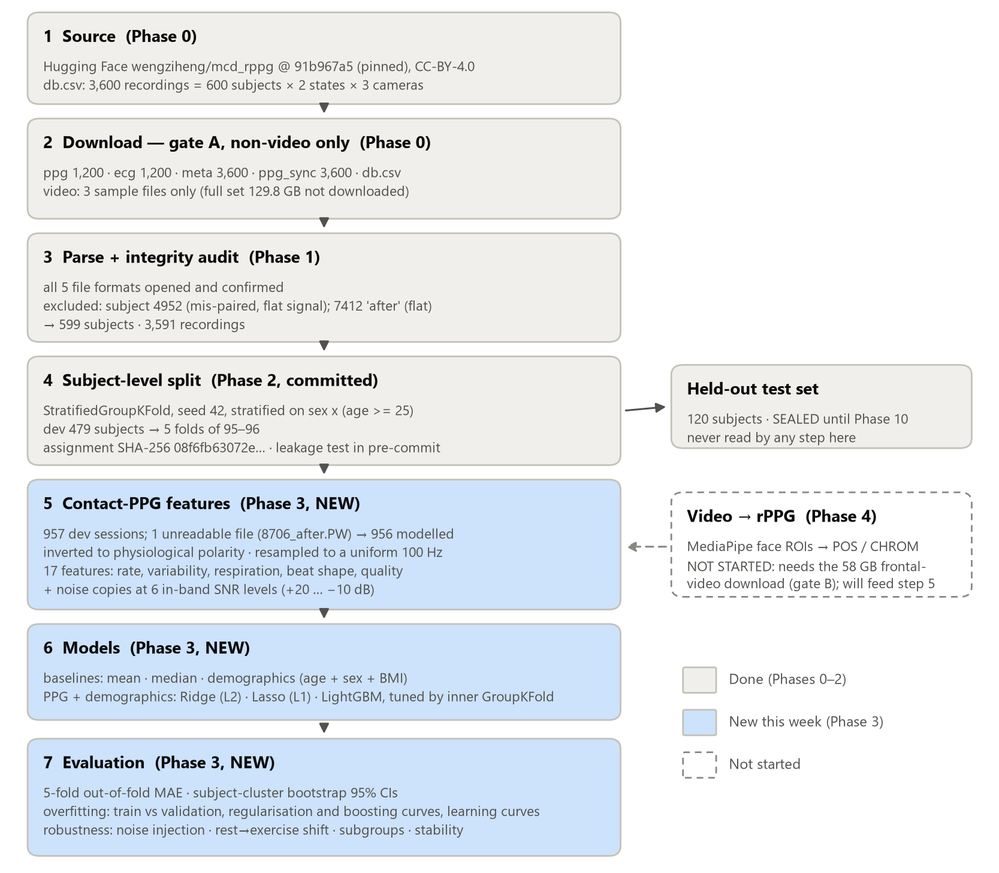

# FaceAI

Contactless health screening from facial video using remote photoplethysmography (rPPG).

**Collaboration:** NTU veNTUre × NHG Health × A\*STAR IHPC

> This README is the **reproducibility record**. This project operates under IRB/DSRB
> oversight, so every reported number must be traceable to a pinned environment.
> Every version below was read back from the environment that was actually built —
> not from what was intended. Environment built **2026-09-10**.

---

## Group 2 pipeline at a glance



Phases 0–3 are complete; Phase 4 (rPPG from video) has not started. The dataset is **not**
in this repository. MCD-rPPG (Egorov et al., ACM MM 2025, doi:10.1145/3746027.3758255,
CC-BY-4.0) is gated on Hugging Face: accept the gate, run `hf auth login`, then fetch the
same non-video files used here (9,603 files, 5.33 GB) at the pinned revision:

```python
from faceai.data.hub import fetch_patterns
fetch_patterns(["README.md", "readme.txt", "db.csv", "ppg/*", "ppg_sync/*", "ecg/*", "meta/*"],
               max_bytes=6_000_000_000)
```

Then, from the activated environment, every number and figure in `reports/` is rebuilt by:

```
make splits    # Phase 2: subject-level splits (also committed in artifacts/)
make test      # 68 tests, including the subject-leakage guard
make phase3    # Phase 3 + 3b: features, 5-fold CV, overfitting, robustness, clinical, reports
```

| Report | Contents |
|---|---|
| [`reports/00_access.md`](reports/00_access.md) | Dataset access probe: source, licence, schema, sizes |
| [`reports/01_eda.md`](reports/01_eda.md) | File formats, integrity audit, exclusions, label EDA |
| [`reports/02_splits.md`](reports/02_splits.md) | Subject-level splits and the leakage guarantee |
| [`reports/03_cv_robustness.md`](reports/03_cv_robustness.md) | Contact-PPG 5-fold CV, overfitting diagnostics, robustness tests |
| [`reports/03b_extensions.md`](reports/03b_extensions.md) | Quality gate, camera timing, clinical thresholds, within-person change |

Binding project rules are in [`CLAUDE.md`](CLAUDE.md); the phase checklist is in
[`PROGRESS.md`](PROGRESS.md).

---

## 1. Detected hardware and OS

| | |
|---|---|
| Machine | GIGABYTE AERO X16 1TH |
| OS | Microsoft Windows 11 Home, 10.0.26200 (build 26200) |
| Architecture | x86-64 (AMD64) |
| CPU | AMD Ryzen AI 7 350 w/ Radeon 860M — 8 cores / 16 threads |
| RAM | 31.1 GB |
| GPU (discrete) | **NVIDIA GeForce RTX 5050 Laptop GPU**, 8 GB VRAM |
| GPU compute capability | **sm_120 (Blackwell)** |
| NVIDIA driver | 581.91 |
| Driver max CUDA runtime | 13.0 |
| GPU (integrated) | AMD Radeon 860M — unused (ROCm is Linux-only) |
| System CUDA Toolkit | **none installed** (not required; wheels bundle their own runtime) |

---

## 2. Environment manager

**Miniforge3 26.7.2-0** — `conda 26.7.2`, `mamba 2.9.0`, installed at `C:\Users\jc180\miniforge3`.

Channel configuration is **`conda-forge` only**. The Anaconda `defaults` channel is not
used anywhere, and the base environment contains no `conda-anaconda-tos` or
`conda-anaconda-telemetry` packages.

> **Licence note.** A pre-existing **Miniconda3** install (`conda 25.7.0`) was found at
> `C:\Users\jc180\miniconda3`, configured with `channels: [defaults]` and carrying
> `conda-anaconda-tos` / `conda-anaconda-telemetry`. Anaconda's terms require a paid
> licence for organisations of 200+ people, explicitly including government bodies and
> academic non-curriculum research — which covers NHG Health and A\*STAR IHPC.
> **That installation was deliberately not used and not modified.** It remains on disk,
> untouched, and is unrelated to this project.

`uv 0.12.11` is also installed (`C:\Users\jc180\.local\bin`) and is on PATH.

**Python: 3.12.14** (conda-forge, CPython).

---

## 3. PyTorch build and why

```
torch 2.14.0+cu130   torchvision 0.29.0+cu130   torchaudio 2.11.0+cu130
index: https://download.pytorch.org/whl/cu130
```

**Why `cu130` specifically:**

1. The RTX 5050 is **Blackwell, compute capability sm_120**. Blackwell requires a
   **CUDA 12.8 or newer** build. A `cu126` wheel installs without complaint and then
   fails at runtime with *"no kernel image is available for execution on the device"* —
   its arch list stops at `sm_90`.
2. The driver (581.91) reports a **maximum supported CUDA runtime of 13.0**, so `cu130`
   is the exact match. `cu132` is also published, but using it would depend on CUDA
   minor-version compatibility rather than a directly supported runtime, so the older
   channel was chosen instead of touching the driver.
3. **Verified empirically, not assumed:**
   ```
   torch.cuda.is_available()   -> True
   torch.version.cuda          -> 13.0
   device                      -> NVIDIA GeForce RTX 5050 Laptop GPU
   compute capability          -> sm_120
   torch.cuda.get_arch_list()  -> ['sm_75','sm_80','sm_86','sm_90','sm_100','sm_120']
   ```
   `sm_120` is present in the build's arch list, and a real GPU matmul returns finite
   values.

**No separate CUDA Toolkit is installed and none is needed** — the wheels bundle their
own CUDA runtime and cuDNN. Only the NVIDIA driver is required.

---

## 4. Pinned versions

Full pins: [`requirements.txt`](requirements.txt) (128 packages) and
[`environment.yml`](environment.yml). [`pyproject.toml`](pyproject.toml) is the primary
manifest and pins the direct dependencies. The headline versions:

| Package | Version | Note |
|---|---|---|
| python | 3.12.14 | conda-forge |
| numpy | **2.2.6** | deliberately pinned `<2.3` — see §5 |
| scipy | 1.18.1 | `scipy.signal` is the rPPG workhorse |
| pandas | **2.3.3** | downgraded from 3.0.5 by neurokit2 (`pandas<3`) |
| matplotlib | 3.11.1 | |
| scikit-learn | 1.9.0 | |
| **opencv-contrib-python** | **5.0.0.93** | the *only* OpenCV variant — see §5 |
| mediapipe | 1.0.1 | Tasks API |
| torch | 2.14.0+cu130 | |
| torchvision | 0.29.0+cu130 | |
| torchaudio | 2.11.0+cu130 | |
| heartpy | 1.2.7 | reports `__version__ == "Version 1.2.6"`; pip metadata says 1.2.7 |
| neurokit2 | 0.2.13 | |
| av (PyAV) | 18.1.0 | |
| decord | 0.6.0 | works on Windows; last released 2021 |
| imageio | 2.37.4 | |
| imageio-ffmpeg | 0.6.0 | bundles its own ffmpeg 7.1 |
| jupyterlab | 4.6.3 | |

**System ffmpeg:** `9.0.1-full_build` (Gyan.FFmpeg via winget), installed under
`%LOCALAPPDATA%\Microsoft\WinGet\Packages` — user scope, no elevation used.
This build is GPL-3.0 (`--enable-gpl --enable-version3`); invoking it as a standalone
CLI tool imposes no licence obligation on this project's own source, but that changes if
the binary is ever redistributed as part of a bundle.
Note `imageio-ffmpeg` ships a *separate* bundled ffmpeg 7.1 that it uses internally.

**Model bundle:** `models/face_landmarker.task` — 3,758,596 bytes,
`sha256 64184e229b263107bc2b804c6625db1341ff2bb731874b0bcc2fe6544e0bc9ff`, from
`https://storage.googleapis.com/mediapipe-models/face_landmarker/face_landmarker/float16/1/face_landmarker.task`
(the pinned `/1/` revision, not `/latest/`). It is **gitignored** — re-download it with
the URL above and check the hash.

### 4a. Group 2 additions — 2026-09-22

Added for the Group 2 biomarker work, resolved with every package above **frozen** by a
constraints file: the dry run and the post-install diff both showed 92 new packages and
**0 changes** to existing ones.

| Package | Version | | Package | Version |
|---|---|---|---|---|
| lightgbm | 4.7.0 | | mlflow | 3.16.1 |
| xgboost | 3.4.1 | | gradio | 6.28.0 |
| catboost | 1.2.10 | | huggingface_hub | 1.32.0 (+ hf-xet 1.6.0) |
| mapie | 1.5.0 | | pyarrow | 25.0.1 |
| pydantic | 2.13.5 | | PyYAML | 6.0.3 |
| pytest / ruff / pre-commit | 9.1.1 / 0.16.8 / 4.6.2 | | make (conda-forge) | 4.4.1 |

- **The full record is now [`env/lockfile.txt`](env/lockfile.txt)** (`pip freeze` +
  `conda list --explicit`). Regenerate it, `requirements.txt` and `environment.yml` from
  the live env after **every** install with `python -m faceai.lockfile` (or `make lock`).
- The project itself is installed editable (`pip install -e . --no-deps`), so
  `python -m faceai.…` works from anywhere. The lockfile generator excludes it from the pins.
- **Telemetry is off** for Hugging Face Hub, Gradio and MLflow (`HF_HUB_DISABLE_TELEMETRY=1`,
  `GRADIO_ANALYTICS_ENABLED=False`, `MLFLOW_DISABLE_TELEMETRY=true`, `DO_NOT_TRACK=true`). These
  are set as conda env vars on `faceai`, and as defaults in `faceai/__init__.py` for runs
  that don't activate the env. Names were checked against the installed sources.
- **MLflow uses a local SQLite store** (`artifacts/mlflow/mlflow.db`). MLflow 3.16 raises an
  error by default on a local *file* store, and SQLite is its default backend now. It is
  still local-only.
- **MAPIE 1.x has a new API** (`SplitConformalRegressor` / `CrossConformalRegressor`, not
  0.x's `MapieRegressor`). It supports Python 3.12.
- `make` comes from conda-forge because Windows doesn't ship it. `libgomp` came in with it;
  torch, LightGBM, XGBoost and CatBoost were checked to load and fit in one process with no
  OpenMP conflict.

---

## 5. Decisions that deviate from the original setup spec

Recorded because a reproducibility record is worthless if it hides its own judgement calls.

**a) `opencv-contrib-python` instead of `opencv-python`.**
MediaPipe 1.0.1 *hard-depends* on `opencv-contrib-python`. Installing `opencv-python`
first and MediaPipe last would have left **two OpenCV variants** in the environment —
the exact conflict the setup spec warns about. `opencv-contrib-python` is a strict
superset of `opencv-python`: same full GUI build, so `cv2.imshow` and webcam capture are
unaffected, plus the contrib modules. It is the single installed variant, asserted by
`tests/verify_env.py`.

**b) NumPy pinned `<2.3` — kept, though the stated rationale has expired.**
PyTorch pulled in numpy 2.5.2; it was pinned back to 2.2.6 per spec. This is compatible
with everything here (`opencv-contrib-python` needs `numpy>=2` with no ceiling,
`mediapipe` is unbounded, `torch` declares no numpy requirement). The original
`_ARRAY_API not found` ABI hazard no longer applies — every package in this stack now
ships numpy-2.x-built wheels — but the pin costs nothing and was verified end to end.

**c) pandas 2.3.3, not 3.x.** `neurokit2 0.2.13` requires `pandas<3`, so pandas was
downgraded from 3.0.5 during the Phase 5 install. This is a resolver outcome, not a choice.

**d) MediaPipe no longer has a protobuf conflict.** MediaPipe 1.0.1 declares no protobuf
dependency at all, so the "install MediaPipe last so it wins the protobuf fight"
rationale is obsolete. It was still installed last, which is harmless.

**e) MediaPipe is no longer CPython-version-sensitive.** It now ships a single
ABI-agnostic `mediapipe-1.0.1-py3-none-win_amd64.whl`, so it is not tied to a specific
CPython release. Python 3.12 was kept regardless (numpy 2.5.x now requires `>=3.12`
anyway), but the original "MediaPipe lags new CPython" justification no longer holds.

**f) dlib / face_recognition deliberately not installed**, per spec. MediaPipe Face
Landmarker covers rPPG ROI selection and needs no C++ toolchain.

---

## 6. Recreate this environment from scratch

Assumes an NVIDIA GPU whose driver supports CUDA runtime 13.0 or newer. On different
hardware, re-derive the PyTorch index URL rather than copying `cu130`.

```powershell
# 1. Miniforge (conda-forge only - do NOT use Anaconda/Miniconda)
#    https://github.com/conda-forge/miniforge/releases  ->  Miniforge3-Windows-x86_64.exe
.\Miniforge3-Windows-x86_64.exe /InstallationType=JustMe /RegisterPython=0 /S /D=%UserProfile%\miniforge3

# 2. Initialise the shell, then OPEN A NEW SHELL (see section 8 - without this,
#    conda/mamba are not on PATH and `mamba activate` fails)
%UserProfile%\miniforge3\condabin\conda.bat init powershell
%UserProfile%\miniforge3\Library\bin\mamba.exe shell init --shell powershell --root-prefix %UserProfile%\miniforge3

# 3. Environment
mamba create -n faceai python=3.12 -y
mamba activate faceai

# 4. Everything else, exactly pinned
pip install -r requirements.txt

# 5. System ffmpeg (user scope, no admin)
winget install Gyan.FFmpeg

# 6. Face Landmarker model bundle
curl -L -o models\face_landmarker.task ^
  https://storage.googleapis.com/mediapipe-models/face_landmarker/face_landmarker/float16/1/face_landmarker.task

# 7. Verify
python tests\verify_env.py
```

Conda-based alternative to steps 3–4: `mamba env create -f environment.yml`

---

## 7. Layout

```
faceai/
├── data/            # datasets - GITIGNORED, never committed
├── notebooks/
├── src/faceai/
├── configs/
├── models/          # face_landmarker.task (gitignored) and model weights
├── results/         # gitignored
├── tests/           # verify_env.py
├── pyproject.toml   # primary dependency manifest
├── environment.yml  # conda fallback
├── requirements.txt # pip fallback
└── README.md
```

---

## 8. Daily commands

These are **PowerShell**. Note that Windows PowerShell 5.1 does **not** support `&&` as
a statement separator — use `;` or separate lines.

```powershell
mamba activate faceai                 # activate
python tests\verify_env.py            # verify the environment
jupyter lab                           # launch JupyterLab
```

`python tests\verify_env.py --no-camera` skips the webcam and landmarker checks, for
headless runs or when nobody is sitting in front of the camera.

### Shell initialisation (required once per machine)

Miniforge was installed with `/RegisterPython=0` and no PATH modification, so `conda`
and `mamba` are **not** on PATH by default and `mamba activate` will not work until the
shell is initialised. This was done on this machine with:

```powershell
C:\Users\jc180\miniforge3\condabin\conda.bat init powershell
C:\Users\jc180\miniforge3\Library\bin\mamba.exe shell init --shell powershell --root-prefix C:\Users\jc180\miniforge3
C:\Users\jc180\miniforge3\condabin\conda.bat config --set auto_activate_base false
```

Both hooks write to `Documents\WindowsPowerShell\profile.ps1`. `conda init` alone gives
you `conda activate` but **not** `mamba activate` — mamba 2.x needs its own `shell init`.
Base auto-activation is deliberately left off, so a new shell starts with the system
Python until you activate.

**Open a new shell after initialising.** Until you do, `python` still resolves to the
system interpreter (`C:\Python314\python.exe`) — never `pip install` into that one.

### Without activating (always works, no shell setup)

```powershell
& "C:\Users\jc180\miniforge3\envs\faceai\python.exe" "C:\Users\jc180\faceai\tests\verify_env.py"
```

---

## 9. Verification status — 2026-09-10

`python tests/verify_env.py` → **19 / 20 checks passed**.

Passing: Python 3.12.14 in an isolated prefix; all 12 required imports; exactly one
OpenCV variant; webcam device 0 capture (640×480, DirectShow backend); Face Landmarker
loading `face_landmarker.task` and detecting **1 face / 478 landmarks** (468 face + 10
iris) via the MediaPipe Tasks API.

**The one failure is environmental, not a defect in this environment:**

```
[FAIL] Accelerator detected -- using device 'cpu'
```

The RTX 5050 was reported by Windows as **Code 45 — "not connected to the computer"**,
along with its companion HDMI-audio functions, because the laptop was running **on
battery**. NVIDIA Advanced Optimus powers the discrete GPU off the PCIe bus in that
state, which also makes `nvidia-smi` fail with a misleading *"insufficient permissions"*
error. Driver files were untouched throughout (`nvcuda.dll` 32.0.15.8191), no reboot
occurred, and the failure is identical with `torch` imported alone — it is not an
import-order conflict.

Earlier in the same session, on AC power, this exact environment ran a real GPU matmul
on `cuda:0` with `sm_120` confirmed present in `torch.cuda.get_arch_list()`. **Plug in
the AC adapter and re-run to get 20/20.**

Note that the verifier deliberately reports this as a FAIL rather than silently falling
back to CPU, so a training run can never quietly land on the wrong device.

## 10. Data handling

`data/` and `results/` are gitignored and **must stay that way**. No patient or
participant video, and no derived identifiable signal, may be committed to this
repository. This environment is for public research datasets only.

The original setup rule was that any git remote must be **private**. On 2026-10-12 the
team chose a **public** repository instead: https://github.com/d-onnn/FaceAI_Batch6_Group2.
That makes the rules above absolute. Only code, configs, aggregate reports and the
subject-ID split assignment are committed; datasets, signals and results never are.
