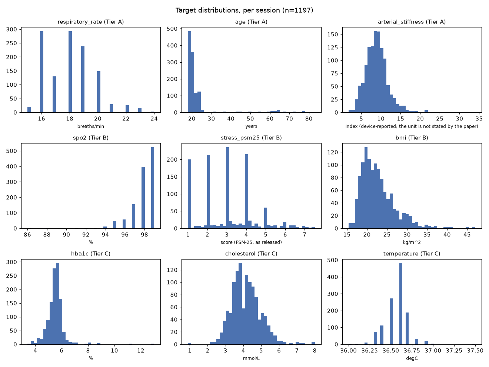
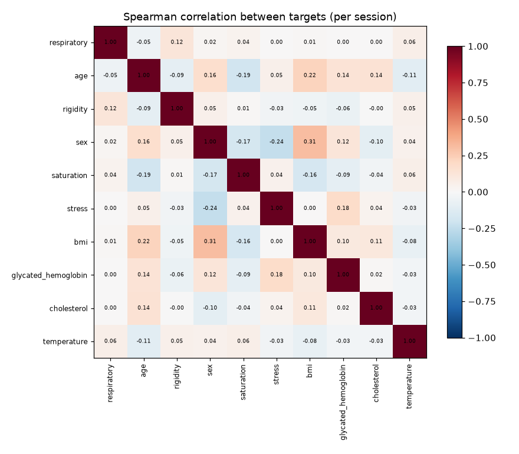
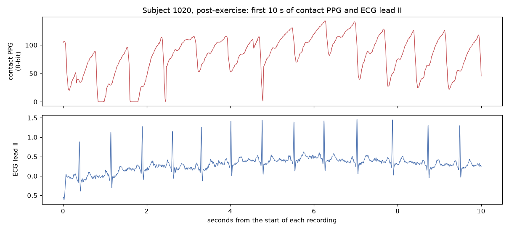

# 01 — Data audit and EDA

Generated 2026-09-23T02:16:00+08:00 by `python -m faceai.eda`. Source: `wengziheng/mcd_rppg` @ `91b967a5`. Aggregates only - no individual row appears here.

## Summary

- **10 of 11 targets have labels.** `glucose` has no column in `db.csv` and cannot be modelled.
- **9 recordings dropped** (600 → 599 subjects): see Exclusions.
- Every file format was opened and confirmed; five quirks found that would silently corrupt downstream work (see the table).
- **The `pulse` label is not a usable HR reference**: it disagrees with simultaneous ECG by 8.7 bpm MAE.

## 1. Format confirmation

| format | opened | confirmed | quirk found |
|---|---|---|---|
| `ecg/*.json` | 1020_after.json | 500 Hz, 12 leads, 30.0 s | lead I has 14900 samples vs 15000 for the rest - stacking must truncate |
| `meta/*.txt` | 1020_FullHDwebcam_after.txt | 5399 frame timestamps, 180.0 s, 30.00 fps mean | rate not constant (median 31.33 fps); undocumented in the brief |
| `ppg/*.PW` | 1020_after.PW | text, 18051 samples, 180.5 s, 100.01 Hz mean, 8-bit values | samples arrive in bursts; 100 Hz is an average only - resample before spectral work |
| `ppg_sync/*.txt` | 1020_FullHDwebcam_after.txt | 5383 rows = one per encoded video frame; median sync error 4.0 ms | column 2 is the frame/PPG time mismatch; 16 fewer rows than `meta/` |
| `video/*.avi` | 1020_FullHDwebcam_after.avi | mpeg4 640x480, 5383 frames, 29.90 fps, 180.0 s | no container duration field; frame count equals the `ppg_sync` row count exactly |

## 2. Integrity

### db.csv paths vs the filename convention

| column | rows_disagreeing_with_filename_convention | unique_paths | present_on_disk |
|---|---|---|---|
| video | 0 | 3600 | 3 |
| meta | 0 | 3600 | 3600 |
| ppg_sync | 0 | 3600 | 3600 |
| ppg | 6 | 1200 | 1200 |
| ecg | 6 | 1200 | 1200 |

Only `ppg` and `ecg` disagree, and every disagreement is subject 4952.

### Degenerate (flat-line) signals — all 3600 `ppg_sync` files scanned

| file | subject | distinct_values | constant_value |
|---|---|---|---|
| 4952_FullHDwebcam_after.txt | 4952 | 1 | 38.000 |
| 4952_FullHDwebcam_before.txt | 4952 | 1 | 150.000 |
| 4952_IriunWebcam_after.txt | 4952 | 1 | 38.000 |
| 4952_IriunWebcam_before.txt | 4952 | 1 | 150.000 |
| 4952_USBVideo_after.txt | 4952 | 1 | 38.000 |
| 4952_USBVideo_before.txt | 4952 | 1 | 150.000 |
| 7412_FullHDwebcam_after.txt | 7412 | 1 | 8.000 |
| 7412_IriunWebcam_after.txt | 7412 | 1 | 8.000 |
| 7412_USBVideo_after.txt | 7412 | 1 | 8.000 |

### Exclusions applied to every downstream phase

- **Subject 4952** — Two independent defects. (1) All 6 rows point `ppg`/`ecg` at the opposite session to their own `step`, uniquely among 600 subjects. (2) All 6 of its ppg_sync files are CONSTANT (150 before, 38 after; std=0), i.e. the synced PPG is a flat line carrying no pulse signal at all. The correct before/after pairing could not be established: the `pulse` label agrees with simultaneous ECG only to ~9 bpm MAE, which cannot adjudicate the ~6 bpm difference between the two candidate files. Excluded rather than guessed.
- **Subject 7412, `after` session** — All 3 ppg_sync files for this session are CONSTANT (value 8.0, std=0) - no pulse signal. The `before` session is healthy and is retained.

Result: 3600 → 3591 recordings, 600 → 599 subjects.

### Why subject 4952's before/after pairing is 'inconclusive', not guessed

| step | pulse label | HR of filename-implied file | HR of db.csv-implied file | verdict |
|---|---|---|---|---|
| after | 105.000 | 96.000 | 90.000 | filename |
| before | 97.000 | 90.000 | 96.000 | db.csv path |

Two adjudication attempts were made and **both were rejected as unreliable**. Correlating the `.PW` waveform against `ppg_sync` failed on known-good control subjects (r ~ 0.04-0.55), because `ppg_sync` has no timestamps and sub-second drift decorrelates a ~1 Hz waveform. Adjudicating by HR then failed because the `pulse` label is itself loose (below). The subject is excluded rather than assigned on a guess.

### Is `pulse` a usable HR reference? No.

| comparison | MAE_bpm | within_5bpm_pct | corr |
|---|---|---|---|
| PPG vs ECG | 4.644 | 65.000 | 0.883 |
| ECG vs pulse label | 8.695 | 45.000 | 0.809 |
| PPG vs pulse label | 9.875 | 40.000 | 0.741 |

Over 40 sessions, PPG-derived HR and ECG-derived HR agree with each other better than either agrees with the `pulse` label. `pulse` is a spot tonometer reading, not a mean over the 180 s recording. **Use contact PPG or ECG as the HR reference in Phases 3-4, never `pulse`.**

### Labels are constant across the 3 cameras of a session

1200 sessions × 16 label columns: **0 sessions vary**. This is why every statistic below is computed per session (n=1197) or per subject (n=599), never over the 3600 recording rows.

### Observed values vs the paper's Table 2 ranges

| target | column | declared | observed | below | above |
|---|---|---|---|---|---|
| respiratory_rate | respiratory | 15.0 .. 24.0 | 15 .. 24 | 0 | 0 |
| age | age | 18.0 .. 83.0 | 18 .. 83 | 0 | 0 |
| arterial_stiffness | rigidity | 1.75 .. 34.02 | 1.75 .. 34.02 | 0 | 0 |
| spo2 | saturation | 86.0 .. 99.0 | 86 .. 99 | 0 | 0 |
| stress_psm25 | stress | 1.0 .. 7.52 | 1 .. 7.52 | 0 | 0 |
| bmi | bmi | 15.39 .. 47.03 | 15.39 .. 47.03 | 0 | 0 |
| hba1c | glycated_hemoglobin | 3.4 .. 13.02 | 3.4 .. 13.02 | 0 | 0 |
| cholesterol | cholesterol | 0.9 .. 8.0 | 0.9 .. 8 | 0 | 0 |
| temperature | temperature | 36.0 .. 37.5 | 36 .. 37.5 | 0 | 0 |

All targets lie inside their declared ranges (allowing for Table 2 being rounded to 2 dp - BMI's true minimum is 15.3894 against a printed 15.39).

### Signal durations, 30 sampled recordings

| index | frames | video_s | fps_mean | sync_rows | frames_minus_sync | ppg_s | ppg_hz | ppg_clipped_pct | ecg_s | ecg_leads |
|---|---|---|---|---|---|---|---|---|---|---|
| mean | 5139.530 | 179.980 | 28.560 | 5121.000 | 18.530 | 180.780 | 100.010 | 0.450 | 30.000 | 12.000 |
| min | 4279.000 | 179.950 | 23.770 | 4257.000 | 0.000 | 180.370 | 100.000 | 0.000 | 30.000 | 12.000 |
| max | 5401.000 | 180.000 | 30.010 | 5401.000 | 63.000 | 182.020 | 100.010 | 1.550 | 30.000 | 12.000 |

## 3. Target availability

| target | column | tier | unit | available | clinically usable |
|---|---|---|---|---|---|
| respiratory_rate | respiratory | A | breaths/min | True | True |
| age | age | A | years | True | True |
| arterial_stiffness | rigidity | A | index (device-reported; the unit is not stated by the paper) | True | True |
| sex | sex | A | category (F/M) | True | True |
| spo2 | saturation | B | % | True | True |
| stress_psm25 | stress | B | score (PSM-25, as released) | True | True |
| bmi | bmi | B | kg/m^2 | True | True |
| hba1c | glycated_hemoglobin | C | % | True | False |
| cholesterol | cholesterol | C | mmol/L | True | False |
| temperature | temperature | C | degC | True | False |
| glucose | **none** | C | mmol/L | False | False |

Tier C targets must never be presented as clinically usable. Blood pressure (`upper_ap`, `lower_ap`) is present in the data but excluded as a target.

## 4. Cohort

- 599 subjects; age 18-83 (median 20), BMI median 21.8.
- Sex: 398 F / 201 M (66% female).
- 1197 sessions (before = rest, after = 15 squats in 30 s).

The cohort is young, Russian/Eastern-European and female-skewed. This is a first-order generalisation risk for Singapore deployment and must be stated beside every result.

## 5. Confound structure (the reason for Phase 6)

Spearman correlation of each target with age, sex (M=1/F=0) and BMI, per session:

| target column | age | sex | bmi |
|---|---|---|---|
| respiratory | -0.047 | 0.021 | 0.013 |
| rigidity | -0.087 | 0.050 | -0.047 |
| saturation | -0.194 | -0.175 | -0.165 |
| stress | 0.053 | -0.237 | 0.003 |
| glycated_hemoglobin | 0.138 | 0.119 | 0.101 |
| cholesterol | 0.141 | -0.095 | 0.106 |
| temperature | -0.105 | 0.042 | -0.076 |

Any target correlating strongly here can be partly predicted from demographics alone, which is exactly what the Phase 6 age+sex+BMI baseline tests for.

## 6. Figures

## 7. Carried into Phase 2

- Split on `patient_id` only, after applying the exclusions above.
- The authors split the same way (`train_test_split` on unique `patient_id`, 20%, seed 43), so their Table 5 numbers are genuine subject-level results and are comparable with ours.
- `ppg_sync` aligns 1:1 with encoded video frames, not with `meta/` rows.
