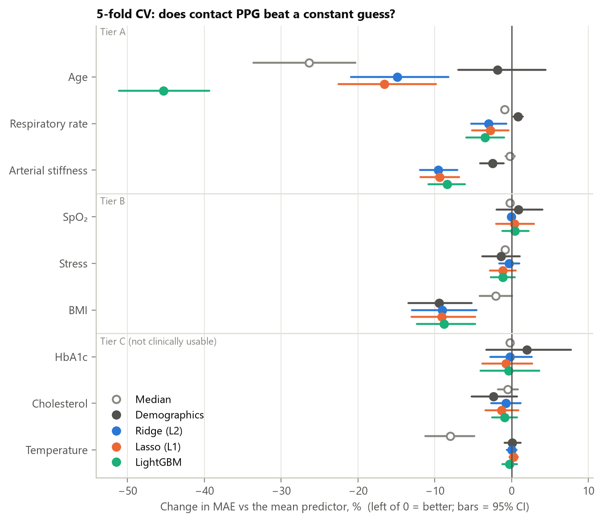
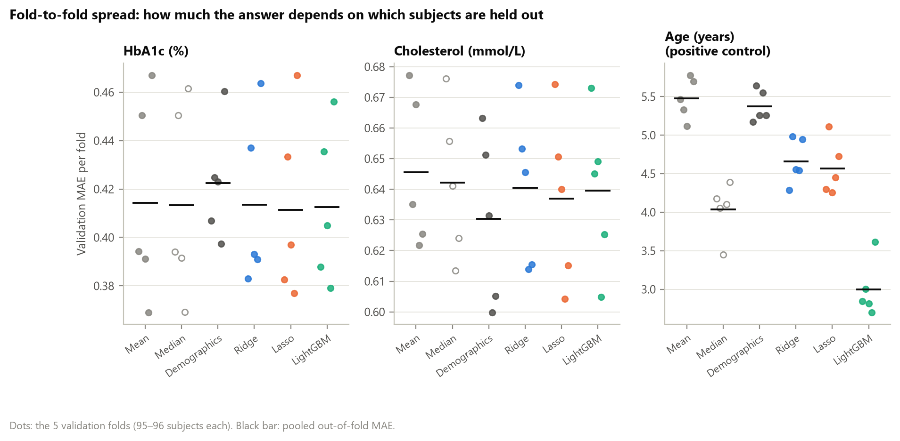
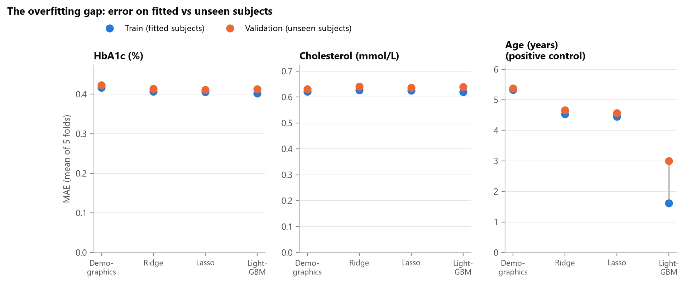
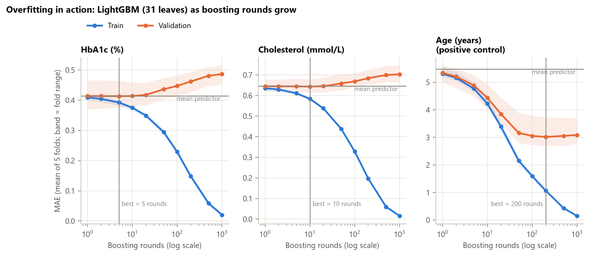
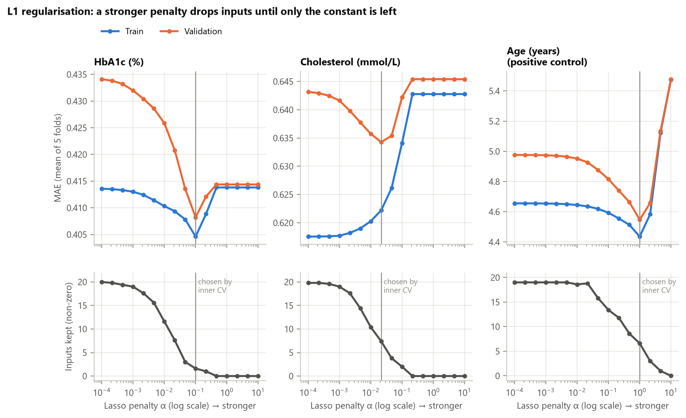
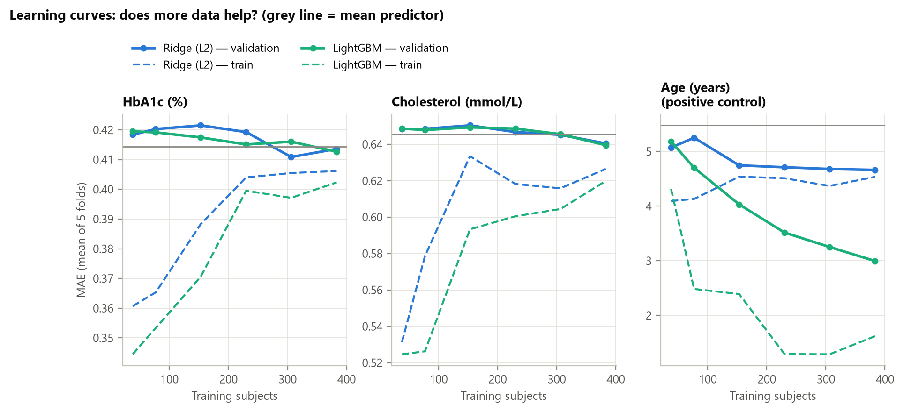
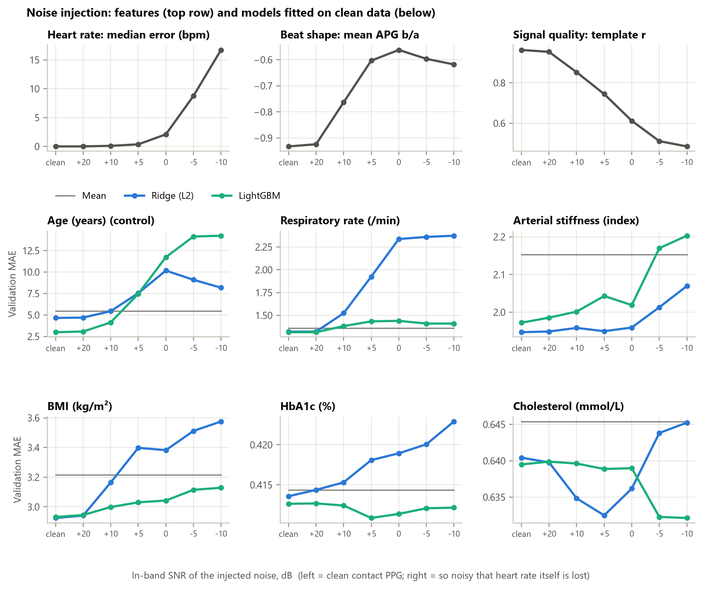
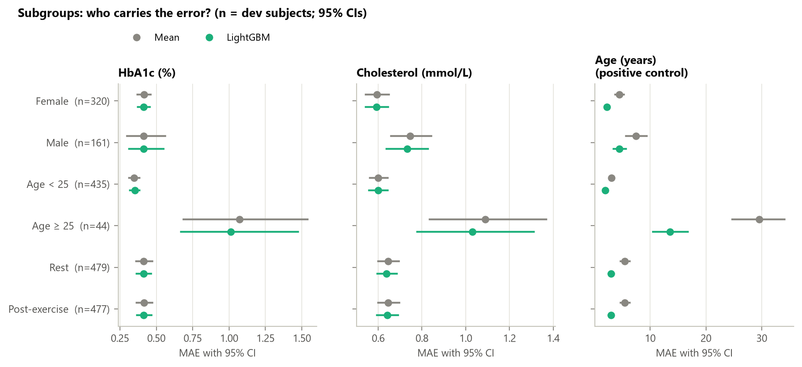

# Phase 3 — Contact-PPG 5-fold cross-validation, overfitting and robustness

_Generated 2026-10-12T21:50:14+08:00 by `python -m faceai.report03` from saved artifacts only._

**Scope.** Contact PPG only (the .PW finger signal) — the best-case signal, before any
camera is involved. No video, no rPPG (Phase 4 has not started). Dev folds only: the 120
held-out test subjects are sealed until Phase 10 and were not read.

**Data.** 956 dev sessions from 479 subjects, the committed
5 folds (`artifacts/splits.parquet`), 17 PPG features + demographics. Bootstrap: 2000 subject-cluster
resamples. Lasso convergence warnings: 0.

## 1. Pipeline


## 2. Data findings made while building it

- **The raw .PW waveform is inverted.** On 40 sampled sessions, the median trough-to-peak
  time was 0.545 s and peak-to-trough 0.140 s — the reverse of a real pulse in every one.
  Features use `255 − raw`. Heart rate is unaffected; beat-shape features are not.
- **One contact-PPG file is corrupt:** `8706_after.PW` (a merged timestamp, a run of NUL
  bytes and a truncated last line; its clock jumps back 18 s). It is reported and left out of
  the features, not repaired. All other 1,199 files parse and have monotonic timestamps
  (largest sampling gap 0.85 s). This scan read file formats only, including test-set files.
- **Respiratory rate from PPG disagrees with the physician count.** Five estimator settings
  were compared on 150 dev sessions (fused RIFV/RIAV/RIIV vs the label):

| Setting | MAE vs label (/min) | Pearson r | Median estimate (/min) |
|---|---|---|---|
| 6-30 /min, no band-pass | 10.04 | +0.06 | 6.6 |
| 6-30 /min, 0.1-0.6 Hz band-pass | 8.17 | +0.06 | 8.4 |
| 9-30 /min, no band-pass | 5.65 | +0.14 | 11.2 |
| 9-30 /min, 0.15-0.6 Hz band-pass | 3.64 | +0.24 | 15.9 |
| 12-30 /min, 0.2-0.6 Hz band-pass (adopted) | 2.43 | +0.34 | 17.8 |
| constant (label median of these sessions) | 1.38 | — | 18.0 |

  Without a band-pass the estimate collapses onto slow drift (~7/min). The adopted 12–30/min
  band is the physiological prior around the paper's 15–24 label range; it was chosen after
  this comparison on dev labels, so the respiratory-rate results below are slightly optimistic.
  Even the best setting is worse than a constant guess — consistent with the label being
  counted at a separate stand before the recording, not during it.

## 3. Five-fold cross-validation results



Pooled out-of-fold MAE with 95% subject-cluster bootstrap CIs. **Strict** = the brief's rule
(model CI does not overlap the mean-predictor CI **and** the demographics CI). **Paired** = the
95% CI of (model − demographics) on the same bootstrap draws lies entirely below 0.

| Target (tier) | Mean | Median | Demographics | Ridge (L2) | Lasso (L1) | LightGBM | Beats both (strict) | Beats demographics (paired) | Paper T5 constant / video model |
|---|---|---|---|---|---|---|---|---|---|
| Age (A) | 5.477 [4.695–6.321] | 4.033 [3.147–4.958] | 5.376 [4.644–6.165] | 4.662 [4.123–5.245] | 4.568 [3.996–5.173] | 2.995 [2.579–3.474] | LightGBM | Ridge, Lasso, LightGBM | 5.71 / 3.91 |
| Respiratory rate (A) | 1.362 [1.305–1.421] | 1.349 [1.291–1.408] | 1.373 [1.315–1.432] | 1.321 [1.266–1.377] | 1.324 [1.268–1.381] | 1.315 [1.258–1.371] | none | Ridge, Lasso, LightGBM | 1.36 / 1.20 |
| Arterial stiffness (A) | 2.153 [2.008–2.299] | 2.148 [2.003–2.294] | 2.099 [1.954–2.248] | 1.947 [1.804–2.093] | 1.951 [1.806–2.098] | 1.972 [1.827–2.117] | none | Ridge, Lasso, LightGBM | 2.19 / 2.04 |
| SpO₂ (B) | 0.877 [0.811–0.950] | 0.876 [0.810–0.948] | 0.885 [0.823–0.954] | 0.877 [0.812–0.948] | 0.880 [0.818–0.949] | 0.881 [0.818–0.949] | none | none | 0.98 / 0.98 |
| Stress (B) | 1.194 [1.113–1.273] | 1.184 [1.103–1.264] | 1.177 [1.102–1.252] | 1.189 [1.112–1.264] | 1.180 [1.104–1.254] | 1.180 [1.103–1.254] | none | none | 1.20 / 1.07 |
| BMI (B) | 3.215 [2.973–3.469] | 3.149 [2.890–3.431] | 2.912 [2.685–3.151] | 2.925 [2.701–3.159] | 2.923 [2.700–3.160] | 2.932 [2.710–3.171] | none | none | 3.18 / 3.37 |
| HbA1c (C) | 0.414 [0.364–0.471] | 0.413 [0.363–0.470] | 0.422 [0.377–0.474] | 0.414 [0.365–0.468] | 0.411 [0.363–0.465] | 0.413 [0.366–0.467] | none | none | 0.43 / 0.41 |
| Cholesterol (C) | 0.645 [0.600–0.693] | 0.642 [0.595–0.690] | 0.630 [0.587–0.677] | 0.641 [0.597–0.687] | 0.637 [0.593–0.685] | 0.640 [0.595–0.688] | none | none | 0.66 / 0.60 |
| Temperature (C) | 0.099 [0.092–0.107] | 0.091 [0.083–0.100] | 0.099 [0.092–0.107] | 0.099 [0.092–0.107] | 0.099 [0.092–0.107] | 0.099 [0.091–0.107] | none | none | — |

Paper Table 5 numbers are context only: a different split and test set, and a video model.

**Reading it.**

- **Positive control passes.** Age: LightGBM 2.995 [2.579–3.474] years vs
  mean 5.477 [4.695–6.321] and demographics 5.376 [4.644–6.165].
  The pipeline can find signal where it exists. Caveat: against the MAE-optimal median
  (4.033 [3.147–4.958]) the CIs overlap, because age is so skewed (cohort median 20).
- **Arterial stiffness and respiratory rate** improve on demographics on the paired test but
  not under the brief's strict rule — promising, not established.
- **BMI:** demographics (age + sex) beat the constant on the paired test, not the strict rule;
  PPG adds nothing on top of them.
- **HbA1c, cholesterol, SpO₂, stress, temperature:** nothing beats a constant guess. For
  HbA1c the best model is within 0.003 of the mean predictor.

### Fold-to-fold spread (the 5-fold robustness check)



| Target | Model | Fold 0 | Fold 1 | Fold 2 | Fold 3 | Fold 4 | Spread (max−min) |
|---|---|---|---|---|---|---|---|
| Age | Demographics | 5.173 | 5.644 | 5.258 | 5.551 | 5.255 | 0.471 |
| Age | Lasso (L1) | 4.298 | 5.112 | 4.253 | 4.451 | 4.727 | 0.859 |
| Age | LightGBM | 2.844 | 3.006 | 2.812 | 2.7 | 3.615 | 0.915 |
| Age | Mean | 5.466 | 5.333 | 5.115 | 5.779 | 5.696 | 0.663 |
| Age | Median | 4.177 | 4.052 | 3.448 | 4.105 | 4.389 | 0.942 |
| Age | Ridge (L2) | 4.285 | 4.982 | 4.554 | 4.545 | 4.943 | 0.697 |
| Cholesterol | Demographics | 0.663 | 0.651 | 0.631 | 0.6 | 0.605 | 0.063 |
| Cholesterol | Lasso (L1) | 0.674 | 0.651 | 0.64 | 0.604 | 0.615 | 0.07 |
| Cholesterol | LightGBM | 0.673 | 0.645 | 0.649 | 0.605 | 0.625 | 0.068 |
| Cholesterol | Mean | 0.677 | 0.635 | 0.668 | 0.622 | 0.625 | 0.056 |
| Cholesterol | Median | 0.676 | 0.656 | 0.641 | 0.613 | 0.624 | 0.063 |
| Cholesterol | Ridge (L2) | 0.674 | 0.653 | 0.646 | 0.614 | 0.615 | 0.06 |
| HbA1c | Demographics | 0.407 | 0.425 | 0.423 | 0.397 | 0.46 | 0.063 |
| HbA1c | Lasso (L1) | 0.383 | 0.433 | 0.397 | 0.377 | 0.467 | 0.09 |
| HbA1c | LightGBM | 0.388 | 0.435 | 0.405 | 0.379 | 0.456 | 0.077 |
| HbA1c | Mean | 0.394 | 0.451 | 0.391 | 0.369 | 0.467 | 0.098 |
| HbA1c | Median | 0.394 | 0.45 | 0.392 | 0.369 | 0.462 | 0.092 |
| HbA1c | Ridge (L2) | 0.383 | 0.437 | 0.393 | 0.391 | 0.464 | 0.081 |

## 4. Overfitting

Overfitting = a model fits the quirks of the subjects it was trained on, so its error on them
(train) is much lower than on subjects it has never seen (validation). Cross-validation does
not prevent it; it **measures** it, by always scoring on unseen subjects.



| Target | Model | Train MAE | Validation MAE | Gap |
|---|---|---|---|---|
| Age | Demographics | 5.331 | 5.376 | 0.045 |
| Age | Lasso (L1) | 4.456 | 4.568 | 0.112 |
| Age | LightGBM | 1.619 | 2.996 | 1.377 |
| Age | Ridge (L2) | 4.535 | 4.662 | 0.127 |
| Arterial stiffness | Demographics | 2.094 | 2.099 | 0.005 |
| Arterial stiffness | Lasso (L1) | 1.92 | 1.951 | 0.03 |
| Arterial stiffness | LightGBM | 1.81 | 1.972 | 0.162 |
| Arterial stiffness | Ridge (L2) | 1.919 | 1.947 | 0.028 |
| BMI | Demographics | 2.865 | 2.911 | 0.047 |
| BMI | Lasso (L1) | 2.786 | 2.923 | 0.136 |
| BMI | LightGBM | 2.694 | 2.932 | 0.237 |
| BMI | Ridge (L2) | 2.778 | 2.925 | 0.146 |
| Cholesterol | Demographics | 0.621 | 0.63 | 0.009 |
| Cholesterol | Lasso (L1) | 0.625 | 0.637 | 0.011 |
| Cholesterol | LightGBM | 0.62 | 0.64 | 0.02 |
| Cholesterol | Ridge (L2) | 0.626 | 0.64 | 0.014 |
| HbA1c | Demographics | 0.416 | 0.422 | 0.006 |
| HbA1c | Lasso (L1) | 0.406 | 0.411 | 0.006 |
| HbA1c | LightGBM | 0.402 | 0.413 | 0.01 |
| HbA1c | Ridge (L2) | 0.406 | 0.414 | 0.007 |
| Respiratory rate | Demographics | 1.365 | 1.373 | 0.008 |
| Respiratory rate | Lasso (L1) | 1.282 | 1.324 | 0.042 |
| Respiratory rate | LightGBM | 1.145 | 1.315 | 0.17 |
| Respiratory rate | Ridge (L2) | 1.284 | 1.321 | 0.037 |
| SpO₂ | Demographics | 0.878 | 0.885 | 0.007 |
| SpO₂ | Lasso (L1) | 0.868 | 0.88 | 0.012 |
| SpO₂ | LightGBM | 0.869 | 0.881 | 0.013 |
| SpO₂ | Ridge (L2) | 0.875 | 0.877 | 0.002 |
| Stress | Demographics | 1.171 | 1.177 | 0.006 |
| Stress | Lasso (L1) | 1.173 | 1.18 | 0.007 |
| Stress | LightGBM | 1.137 | 1.18 | 0.043 |
| Stress | Ridge (L2) | 1.171 | 1.19 | 0.019 |
| Temperature | Demographics | 0.099 | 0.099 | 0.0 |
| Temperature | Lasso (L1) | 0.099 | 0.099 | 0.001 |
| Temperature | LightGBM | 0.097 | 0.099 | 0.002 |
| Temperature | Ridge (L2) | 0.098 | 0.099 | 0.001 |



With 31 leaves and no early stopping, LightGBM drives HbA1c **training** error towards zero
while **validation** error rises above the mean predictor: it memorises noise. For age the
validation error falls and then flattens — there is real signal to learn first.

**Regularisation** limits that complexity. L2 (Ridge) shrinks all weights towards zero; L1
(Lasso) can set weights exactly to zero, dropping inputs. For trees the levers are fewer
leaves, fewer rounds and a minimum leaf size. In every case the penalty was chosen by an
inner CV inside the training folds, never on the fold being scored.



For HbA1c the inner CV keeps 0–2 of 20 inputs — almost the constant. For HbA1c, cholesterol,
SpO₂ and temperature it also chose LightGBM's smallest or next-smallest setting (2–4 leaves,
25–50 rounds) in every fold, and for temperature Ridge's strongest penalty in 2 of 5 folds:
regularisation correctly shrinking towards the mean when there is nothing to learn.



More subjects do not move HbA1c or cholesterol validation error; for age they keep helping.

## 5. Robustness

### Noise injection



| Level | HR error median (bpm) | HR error > 5 bpm (%) | Mean APG b/a | Mean template r | Sessions with a NaN feature (%) |
|---|---|---|---|---|---|
| clean | 0.0 | 0.0 | -0.933 | 0.963 | 0.209 |
| +20 dB | 0.01 | 0.0 | -0.924 | 0.954 | 0.209 |
| +10 dB | 0.099 | 0.105 | -0.763 | 0.853 | 0.0 |
| +5 dB | 0.367 | 1.464 | -0.603 | 0.745 | 0.209 |
| 0 dB | 2.093 | 22.49 | -0.563 | 0.612 | 8.054 |
| -5 dB | 8.754 | 73.013 | -0.597 | 0.512 | 91.213 |
| -10 dB | 16.726 | 88.912 | -0.618 | 0.485 | 99.895 |

| Target | Model | clean | +20 dB | +10 dB | +5 dB | 0 dB | -5 dB | -10 dB |
|---|---|---|---|---|---|---|---|---|
| HbA1c | Mean | 0.414 | 0.414 | 0.414 | 0.414 | 0.414 | 0.414 | 0.414 |
| HbA1c | Ridge (L2) | 0.414 | 0.414 | 0.415 | 0.418 | 0.419 | 0.42 | 0.423 |
| HbA1c | LightGBM | 0.413 | 0.413 | 0.412 | 0.411 | 0.411 | 0.412 | 0.412 |
| Cholesterol | Mean | 0.645 | 0.645 | 0.645 | 0.645 | 0.645 | 0.645 | 0.645 |
| Cholesterol | Ridge (L2) | 0.64 | 0.64 | 0.635 | 0.632 | 0.636 | 0.644 | 0.645 |
| Cholesterol | LightGBM | 0.64 | 0.64 | 0.64 | 0.639 | 0.639 | 0.632 | 0.632 |
| SpO₂ | Mean | 0.877 | 0.877 | 0.877 | 0.877 | 0.877 | 0.877 | 0.877 |
| SpO₂ | Ridge (L2) | 0.877 | 0.877 | 0.878 | 0.881 | 0.884 | 0.887 | 0.887 |
| SpO₂ | LightGBM | 0.881 | 0.881 | 0.881 | 0.881 | 0.881 | 0.881 | 0.881 |
| Stress | Mean | 1.194 | 1.194 | 1.194 | 1.194 | 1.194 | 1.194 | 1.194 |
| Stress | Ridge (L2) | 1.19 | 1.189 | 1.182 | 1.185 | 1.216 | 1.227 | 1.228 |
| Stress | LightGBM | 1.18 | 1.179 | 1.184 | 1.187 | 1.187 | 1.187 | 1.189 |
| Temperature | Mean | 0.099 | 0.099 | 0.099 | 0.099 | 0.099 | 0.099 | 0.099 |
| Temperature | Ridge (L2) | 0.099 | 0.099 | 0.098 | 0.098 | 0.097 | 0.097 | 0.097 |
| Temperature | LightGBM | 0.099 | 0.099 | 0.099 | 0.1 | 0.1 | 0.101 | 0.101 |
| Respiratory rate | Mean | 1.362 | 1.362 | 1.362 | 1.362 | 1.362 | 1.362 | 1.362 |
| Respiratory rate | Ridge (L2) | 1.321 | 1.322 | 1.524 | 1.925 | 2.337 | 2.36 | 2.374 |
| Respiratory rate | LightGBM | 1.315 | 1.315 | 1.382 | 1.434 | 1.439 | 1.41 | 1.41 |
| Arterial stiffness | Mean | 2.153 | 2.153 | 2.153 | 2.153 | 2.153 | 2.153 | 2.153 |
| Arterial stiffness | Ridge (L2) | 1.947 | 1.949 | 1.959 | 1.95 | 1.959 | 2.013 | 2.07 |
| Arterial stiffness | LightGBM | 1.972 | 1.986 | 2.002 | 2.043 | 2.019 | 2.17 | 2.203 |
| BMI | Mean | 3.215 | 3.215 | 3.215 | 3.215 | 3.215 | 3.215 | 3.215 |
| BMI | Ridge (L2) | 2.925 | 2.941 | 3.164 | 3.398 | 3.382 | 3.512 | 3.575 |
| BMI | LightGBM | 2.932 | 2.945 | 2.999 | 3.03 | 3.042 | 3.115 | 3.129 |
| Age | Mean | 5.478 | 5.478 | 5.478 | 5.478 | 5.478 | 5.478 | 5.478 |
| Age | Ridge (L2) | 4.662 | 4.697 | 5.442 | 7.548 | 10.169 | 9.1 | 8.18 |
| Age | LightGBM | 2.996 | 3.076 | 4.136 | 7.471 | 11.735 | 14.135 | 14.229 |

Heart rate survives down to +5 dB; beat shape degrades from +10 dB. Models fitted on clean
contact PPG and fed noisy features do not fail gracefully: for age and respiratory rate they
become **worse than the constant** at 0 dB and below. HbA1c and cholesterol look “robust” only
because their models learned almost nothing. Phase 4 must therefore either train on rPPG
itself or gate predictions on signal quality.

### Rest → post-exercise shift

Models fitted on rest sessions only, scored on unseen subjects' rest and post-exercise sessions:

| Target | Model | Scored on rest | Scored on post-exercise |
|---|---|---|---|
| Age | LightGBM | 3.5 | 3.759 |
| Age | Mean | 5.468 | 5.475 |
| Age | Ridge (L2) | 4.663 | 4.641 |
| Arterial stiffness | LightGBM | 1.975 | 2.014 |
| Arterial stiffness | Mean | 2.088 | 2.211 |
| Arterial stiffness | Ridge (L2) | 1.933 | 1.954 |
| BMI | LightGBM | 2.947 | 2.939 |
| BMI | Mean | 3.223 | 3.21 |
| BMI | Ridge (L2) | 2.943 | 2.942 |
| Cholesterol | LightGBM | 0.644 | 0.643 |
| Cholesterol | Mean | 0.645 | 0.646 |
| Cholesterol | Ridge (L2) | 0.646 | 0.645 |
| HbA1c | LightGBM | 0.41 | 0.412 |
| HbA1c | Mean | 0.414 | 0.415 |
| HbA1c | Ridge (L2) | 0.413 | 0.413 |
| Respiratory rate | LightGBM | 0.967 | 2.316 |
| Respiratory rate | Mean | 0.963 | 2.379 |
| Respiratory rate | Ridge (L2) | 0.968 | 2.336 |
| SpO₂ | LightGBM | 0.815 | 0.977 |
| SpO₂ | Mean | 0.82 | 0.958 |
| SpO₂ | Ridge (L2) | 0.793 | 0.978 |
| Stress | LightGBM | 1.199 | 1.183 |
| Stress | Mean | 1.195 | 1.194 |
| Stress | Ridge (L2) | 1.194 | 1.188 |
| Temperature | LightGBM | 0.101 | 0.099 |
| Temperature | Mean | 0.101 | 0.1 |
| Temperature | Ridge (L2) | 0.101 | 0.098 |

Respiratory-rate and SpO₂ errors rise post-exercise for every model, including the
constant, because their labels change after exercise: respiratory rate rises from
16.9 to 19.2/min on average, and SpO₂ falls from
98.12% to 97.90% with a wider spread
(SD 1.20 → 1.44). A rest-trained model cannot
anticipate it. Arterial stiffness is also re-measured each session (mean
8.80 → 9.35).

### Subgroups



| Target | Factor | Level | Model | Subjects | MAE [95% CI] |
|---|---|---|---|---|---|
| HbA1c | sex | F | Mean | 320 | 0.416 [0.369–0.462] |
| HbA1c | sex | F | Demographics | 320 | 0.426 [0.384–0.471] |
| HbA1c | sex | F | LightGBM | 320 | 0.412 [0.372–0.457] |
| HbA1c | sex | M | Mean | 161 | 0.412 [0.300–0.561] |
| HbA1c | sex | M | Demographics | 161 | 0.416 [0.312–0.545] |
| HbA1c | sex | M | LightGBM | 161 | 0.413 [0.312–0.549] |
| HbA1c | age band | < 25 | Mean | 435 | 0.348 [0.314–0.383] |
| HbA1c | age band | < 25 | Demographics | 435 | 0.361 [0.330–0.392] |
| HbA1c | age band | < 25 | LightGBM | 435 | 0.352 [0.320–0.384] |
| HbA1c | age band | >= 25 | Mean | 44 | 1.071 [0.688–1.541] |
| HbA1c | age band | >= 25 | Demographics | 44 | 1.033 [0.716–1.448] |
| HbA1c | age band | >= 25 | LightGBM | 44 | 1.013 [0.669–1.474] |
| HbA1c | state | post-exercise | Mean | 477 | 0.415 [0.365–0.473] |
| HbA1c | state | post-exercise | Demographics | 477 | 0.423 [0.378–0.473] |
| HbA1c | state | post-exercise | LightGBM | 477 | 0.414 [0.368–0.466] |
| HbA1c | state | rest | Mean | 479 | 0.414 [0.362–0.473] |
| HbA1c | state | rest | Demographics | 479 | 0.422 [0.377–0.474] |
| HbA1c | state | rest | LightGBM | 479 | 0.412 [0.365–0.464] |
| Cholesterol | sex | F | Mean | 320 | 0.595 [0.542–0.650] |
| Cholesterol | sex | F | Demographics | 320 | 0.600 [0.549–0.650] |
| Cholesterol | sex | F | LightGBM | 320 | 0.593 [0.543–0.646] |
| Cholesterol | sex | M | Mean | 161 | 0.746 [0.658–0.842] |
| Cholesterol | sex | M | Demographics | 161 | 0.692 [0.603–0.782] |
| Cholesterol | sex | M | LightGBM | 161 | 0.732 [0.638–0.827] |
| Cholesterol | age band | < 25 | Mean | 435 | 0.600 [0.561–0.643] |
| Cholesterol | age band | < 25 | Demographics | 435 | 0.591 [0.547–0.632] |
| Cholesterol | age band | < 25 | LightGBM | 435 | 0.600 [0.559–0.643] |
| Cholesterol | age band | >= 25 | Mean | 44 | 1.090 [0.835–1.368] |
| Cholesterol | age band | >= 25 | Demographics | 44 | 1.019 [0.783–1.268] |
| Cholesterol | age band | >= 25 | LightGBM | 44 | 1.031 [0.779–1.311] |
| Cholesterol | state | post-exercise | Mean | 477 | 0.646 [0.599–0.697] |
| Cholesterol | state | post-exercise | Demographics | 477 | 0.630 [0.583–0.680] |
| Cholesterol | state | post-exercise | LightGBM | 477 | 0.642 [0.594–0.691] |
| Cholesterol | state | rest | Mean | 479 | 0.645 [0.599–0.694] |
| Cholesterol | state | rest | Demographics | 479 | 0.630 [0.587–0.679] |
| Cholesterol | state | rest | LightGBM | 479 | 0.638 [0.596–0.685] |

The 44 dev subjects aged 25 or over are much harder to predict:

- HbA1c: mean-predictor MAE 1.071 for age ≥ 25 vs 0.348 for < 25 (3.1×); the older group is 9.2% of sessions but 23.8% of the total error.
- Cholesterol: mean-predictor MAE 1.090 for age ≥ 25 vs 0.600 for < 25 (1.8×); the older group is 9.2% of sessions but 15.5% of the total error.

No model closes that gap: their labels sit far from a young cohort's mean, and the
PPG features do not tell the models which way an older subject deviates.

### Stability across a person's two sessions

| Target | Model | Subjects | Label identical (%) | Prediction shift median | 90th pct | Max |
|---|---|---|---|---|---|---|
| HbA1c | Ridge (L2) | 477 | 99.581 | 0.021 | 0.055 | 0.423 |
| HbA1c | Lasso (L1) | 477 | 99.581 | 0.0 | 0.0 | 0.046 |
| HbA1c | LightGBM | 477 | 99.581 | 0.0 | 0.027 | 0.201 |
| Cholesterol | Ridge (L2) | 477 | 99.79 | 0.026 | 0.095 | 0.268 |
| Cholesterol | Lasso (L1) | 477 | 99.79 | 0.004 | 0.039 | 0.2 |
| Cholesterol | LightGBM | 477 | 99.79 | 0.0 | 0.066 | 0.255 |

Labels are identical across sessions for almost everyone, so any prediction shift is driven by
the session (heart rate, pulse shape), not the biomarker. Shifts are small because the models
are close to constant.

### Not run

- **Adversarial testing** — crafted worst-case inputs. Meaningful for deep models on raw
  signals; deferred to Phase 8.
- **Leakage demonstration** (deliberately random split) — would break the project's
  never-random-split rule; not run without explicit approval.

## 6. Reproduce

```
make features      # contact-PPG features, clean + 6 noise levels (~1 min)
make cv            # 5-fold CV, bootstrap CIs (~30 s)
make diagnostics   # regularisation, boosting and learning curves (~1 min)
make robustness    # noise, shift, subgroups, stability (~1 min)
make report03      # this report and its figures
```

Feature table: 956 modelled sessions; features: `hr_mean_bpm, hr_spectral_bpm, ibi_sdnn_ms, ibi_rmssd_ms, ibi_pnn50_pct, resp_rate_rifv, resp_rate_riav, resp_rate_riiv, resp_rate_fused, rise_time_s, width50_s, systolic_frac, apg_b_a, amp_cv, skewness, kurtosis, sqi_template_r`.
