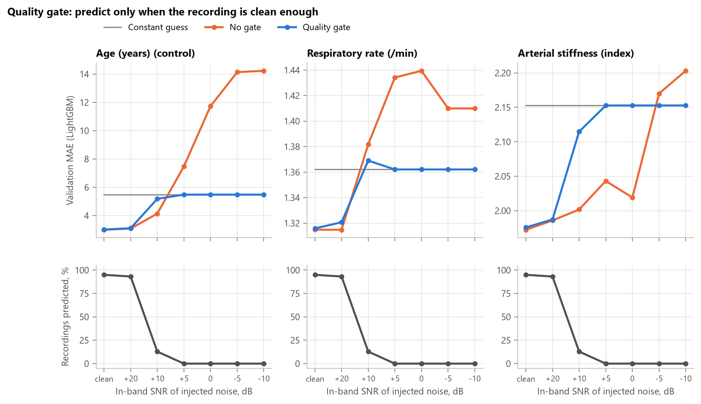
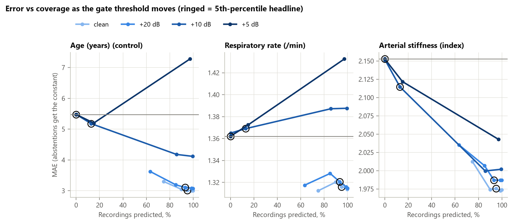
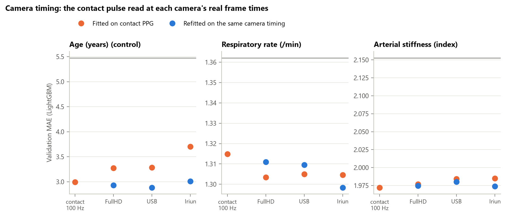
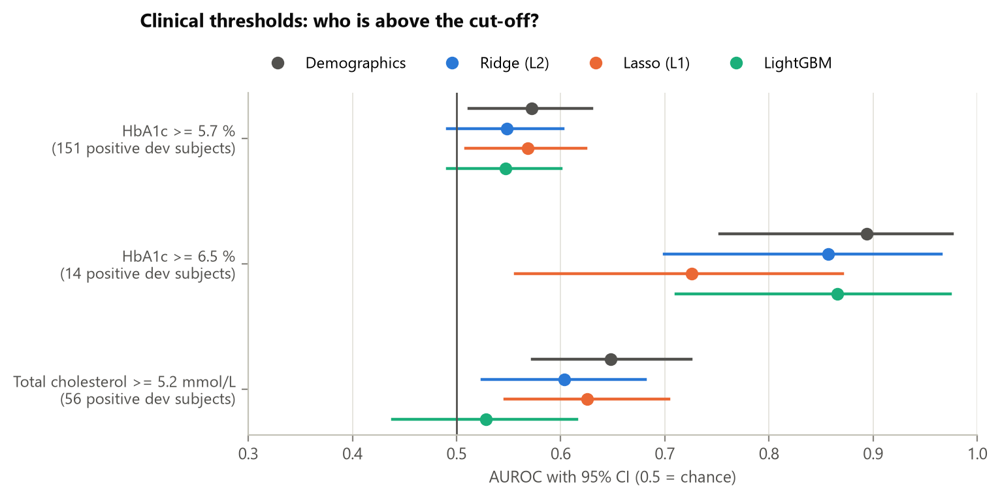
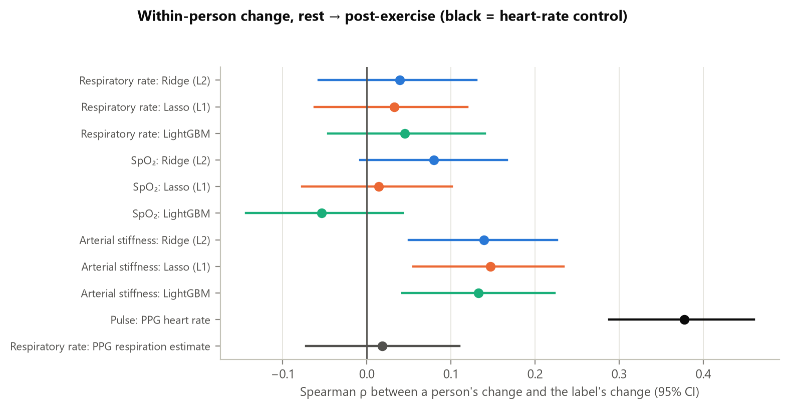

# Phase 3b — Quality gate, camera timing, clinical thresholds, within-person change

_Generated 2026-10-13T15:13:04+08:00 by `python -m faceai.report03b` from saved artifacts only._

Extensions of the Phase 3 contact-PPG work (`reports/03_cv_robustness.md`), on the
same dev folds and models. No new data, no video, and the held-out test set is not read.

## 1. Quality gate — verify every recording before predicting

_Origin: BetterMush (inline pass/reject of every meal instead of batch sampling) and
Pure-Stream (only items that pass inspection are diverted; everything else takes the
normal route)._

A model predicts only when the recording's template-match quality (`sqi_template_r`) is
at least the 5th percentile of its own training fold; otherwise it
abstains and the training-fold mean is reported instead. The threshold comes from
training data only and was fixed before any gate result was seen.



Validation MAE, **no gate → gated** (noise columns are in-band SNR in dB; the last
three are the camera-timed inputs of section 2). Coverage is the same for every target
because the gate looks only at signal quality.

| Target, model | clean | +20 | +10 | +5 | 0 | -5 | -10 | FullHD | USB | Iriun |
|---|---|---|---|---|---|---|---|---|---|---|
| Recordings predicted | 95.0% | 93.2% | 12.9% | 0.0% | 0.0% | 0.0% | 0.0% | 95.3% | 95.1% | 95.2% |
| Age, Ridge (L2) | 4.662 → 4.595 | 4.697 → 4.652 | 5.442 → 5.298 | 7.548 → 5.478 | 10.169 → 5.478 | 9.100 → 5.478 | 8.180 → 5.478 | 4.886 → 4.817 | 4.878 → 4.822 | 5.088 → 5.036 |
| Age, LightGBM | 2.996 → 3.007 | 3.076 → 3.105 | 4.136 → 5.178 | 7.471 → 5.478 | 11.735 → 5.478 | 14.135 → 5.478 | 14.229 → 5.478 | 3.275 → 3.266 | 3.285 → 3.281 | 3.703 → 3.707 |
| Respiratory rate, Ridge (L2) | 1.321 → 1.310 | 1.322 → 1.318 | 1.524 → 1.372 | 1.925 → 1.362 | 2.337 → 1.362 | 2.360 → 1.362 | 2.374 → 1.362 | 1.317 → 1.310 | 1.318 → 1.311 | 1.324 → 1.317 |
| Respiratory rate, LightGBM | 1.315 → 1.316 | 1.315 → 1.321 | 1.382 → 1.369 | 1.434 → 1.362 | 1.439 → 1.362 | 1.410 → 1.362 | 1.410 → 1.362 | 1.303 → 1.306 | 1.305 → 1.311 | 1.305 → 1.306 |
| Arterial stiffness, Ridge (L2) | 1.947 → 1.958 | 1.949 → 1.961 | 1.959 → 2.118 | 1.950 → 2.153 | 1.959 → 2.153 | 2.013 → 2.153 | 2.070 → 2.153 | 1.941 → 1.956 | 1.939 → 1.950 | 1.938 → 1.953 |
| Arterial stiffness, LightGBM | 1.972 → 1.976 | 1.986 → 1.987 | 2.002 → 2.115 | 2.043 → 2.153 | 2.019 → 2.153 | 2.170 → 2.153 | 2.203 → 2.153 | 1.977 → 1.981 | 1.984 → 1.987 | 1.985 → 1.988 |
| BMI, Ridge (L2) | 2.925 → 2.947 | 2.941 → 2.969 | 3.164 → 3.248 | 3.398 → 3.215 | 3.382 → 3.215 | 3.512 → 3.215 | 3.575 → 3.215 | 2.910 → 2.937 | 2.911 → 2.935 | 2.892 → 2.923 |
| BMI, LightGBM | 2.932 → 2.966 | 2.945 → 2.982 | 2.999 → 3.201 | 3.030 → 3.215 | 3.042 → 3.215 | 3.115 → 3.215 | 3.129 → 3.215 | 2.938 → 2.973 | 2.930 → 2.963 | 2.922 → 2.957 |
| HbA1c, Ridge (L2) | 0.414 → 0.413 | 0.414 → 0.413 | 0.415 → 0.414 | 0.418 → 0.414 | 0.419 → 0.414 | 0.420 → 0.414 | 0.423 → 0.414 | 0.414 → 0.412 | 0.414 → 0.413 | 0.413 → 0.412 |
| HbA1c, LightGBM | 0.413 → 0.413 | 0.413 → 0.413 | 0.412 → 0.412 | 0.411 → 0.414 | 0.411 → 0.414 | 0.412 → 0.414 | 0.412 → 0.414 | 0.412 → 0.413 | 0.412 → 0.413 | 0.412 → 0.413 |
| Cholesterol, Ridge (L2) | 0.640 → 0.641 | 0.640 → 0.641 | 0.635 → 0.646 | 0.632 → 0.645 | 0.636 → 0.645 | 0.644 → 0.645 | 0.645 → 0.645 | 0.642 → 0.642 | 0.641 → 0.642 | 0.643 → 0.644 |
| Cholesterol, LightGBM | 0.640 → 0.641 | 0.640 → 0.641 | 0.640 → 0.646 | 0.639 → 0.645 | 0.639 → 0.645 | 0.632 → 0.645 | 0.632 → 0.645 | 0.640 → 0.641 | 0.640 → 0.641 | 0.640 → 0.641 |

**Reading it.** The gate turns catastrophic failures into the constant guess: age at
0 dB goes from 11.7 to 5.5 years, respiratory rate (Ridge) from
2.34 to 1.36/min. On clean contact PPG it adds at most
0.034 to any shown target's error. But the 5th-percentile
setting is conservative: at +10 dB it abstains on 87% of recordings,
discarding predictions that were still better than the constant. The sweep below
shows the trade-off to choose a deployment setting from.

**Blind spot.** The gate does not fire on the camera-timed inputs (coverage stays
about 95%) even though age error rises there (section 2): quality is high but the pulse
shape has shifted. A quality gate catches noise, not a change of input domain.



## 2. Camera timing — a controlled scenario variation

_Origin: Graphyti (vary one controlled factor at a time to test a model on conditions
that are hard to collect)._

The contact pulse is read at every frame each camera actually captured (real frame
times from `meta/`, which share the PPG clock: ~30 fps FullHD/USB, ~24 fps Iriun, with
their jitter and gaps), then re-interpolated to 100 Hz exactly as a camera signal will
be. This isolates the camera's **timing** only — not its optics, site or noise.



Feature change versus the 100 Hz contact value (mean shift; Pearson r):

| Camera | HR shift (bpm) | HR r | Rise-time shift (s) | Rise-time r | APG b/a shift | APG b/a r | Quality r |
|---|---|---|---|---|---|---|---|
| FullHDwebcam | -0.0132 | 1.0 | 0.0058 | 0.9762 | -0.0268 | 0.9559 | 0.8802 |
| USBVideo | -0.017 | 0.9999 | 0.0058 | 0.9768 | -0.0271 | 0.9596 | 0.8905 |
| IriunWebcam | -0.0189 | 0.9999 | 0.0096 | 0.9878 | -0.039 | 0.9484 | 0.8933 |

Validation MAE by input:

| Target | Fitted on | Model | Contact 100 Hz | FullHDwebcam | USBVideo | IriunWebcam |
|---|---|---|---|---|---|---|
| Age | clean | LightGBM | 2.996 | 3.275 | 3.285 | 3.703 |
| Age | clean | Ridge (L2) | 4.662 | 4.886 | 4.878 | 5.088 |
| Age | same camera | LightGBM | — | 2.93 | 2.886 | 3.013 |
| Age | same camera | Ridge (L2) | — | 4.635 | 4.659 | 4.608 |
| Arterial stiffness | clean | LightGBM | 1.972 | 1.977 | 1.984 | 1.985 |
| Arterial stiffness | clean | Ridge (L2) | 1.947 | 1.941 | 1.939 | 1.938 |
| Arterial stiffness | same camera | LightGBM | — | 1.975 | 1.98 | 1.974 |
| Arterial stiffness | same camera | Ridge (L2) | — | 1.949 | 1.943 | 1.947 |
| BMI | clean | LightGBM | 2.932 | 2.938 | 2.93 | 2.922 |
| BMI | clean | Ridge (L2) | 2.925 | 2.91 | 2.911 | 2.892 |
| BMI | same camera | LightGBM | — | 2.942 | 2.932 | 2.922 |
| BMI | same camera | Ridge (L2) | — | 2.922 | 2.927 | 2.915 |
| Cholesterol | clean | LightGBM | 0.64 | 0.64 | 0.64 | 0.64 |
| Cholesterol | clean | Ridge (L2) | 0.64 | 0.642 | 0.641 | 0.643 |
| Cholesterol | same camera | LightGBM | — | 0.64 | 0.64 | 0.64 |
| Cholesterol | same camera | Ridge (L2) | — | 0.641 | 0.639 | 0.638 |
| HbA1c | clean | LightGBM | 0.413 | 0.412 | 0.412 | 0.412 |
| HbA1c | clean | Ridge (L2) | 0.414 | 0.414 | 0.414 | 0.413 |
| HbA1c | same camera | LightGBM | — | 0.413 | 0.413 | 0.413 |
| HbA1c | same camera | Ridge (L2) | — | 0.411 | 0.412 | 0.411 |
| Respiratory rate | clean | LightGBM | 1.315 | 1.303 | 1.305 | 1.305 |
| Respiratory rate | clean | Ridge (L2) | 1.321 | 1.317 | 1.318 | 1.324 |
| Respiratory rate | same camera | LightGBM | — | 1.311 | 1.31 | 1.298 |
| Respiratory rate | same camera | Ridge (L2) | — | 1.316 | 1.315 | 1.318 |
| SpO₂ | clean | LightGBM | 0.881 | 0.881 | 0.881 | 0.881 |
| SpO₂ | clean | Ridge (L2) | 0.877 | 0.877 | 0.877 | 0.877 |
| SpO₂ | same camera | LightGBM | — | 0.881 | 0.881 | 0.881 |
| SpO₂ | same camera | Ridge (L2) | — | 0.877 | 0.877 | 0.877 |
| Stress | clean | LightGBM | 1.18 | 1.18 | 1.181 | 1.181 |
| Stress | clean | Ridge (L2) | 1.19 | 1.189 | 1.188 | 1.187 |
| Stress | same camera | LightGBM | — | 1.184 | 1.189 | 1.179 |
| Stress | same camera | Ridge (L2) | — | 1.19 | 1.19 | 1.189 |
| Temperature | clean | LightGBM | 0.099 | 0.099 | 0.099 | 0.099 |
| Temperature | clean | Ridge (L2) | 0.099 | 0.099 | 0.099 | 0.099 |
| Temperature | same camera | LightGBM | — | 0.099 | 0.099 | 0.099 |
| Temperature | same camera | Ridge (L2) | — | 0.099 | 0.099 | 0.099 |

**Reading it.** Heart rate is unchanged by camera timing (r ≥ 0.9999).
Pulse-shape features shift slightly and consistently: rise time +6 to +10 ms,
APG b/a -0.039 to -0.027 (r 0.98–0.99 and 0.95–0.96); the quality score
agrees less (r 0.88–0.89). Rate-based targets are untouched. The
shape-dependent age model degrades — 3.00 → 3.28 years at FullHD and
3.70 at Iriun's ~24 fps — and refitting on the same timing
recovers it (2.93 / 3.01). The contact-to-camera gap is
therefore not mainly about frame timing: Phase 4 should spend its effort on optical
noise and signal quality, and train on the signal it will be deployed on.

## 3. Clinical thresholds — judged against recognised standards

_Origin: BetterMush (built around the IDDSI framework) and NatureRisk (built around
TNFD, with every conclusion linked to its evidence)._



| Threshold | Positive dev subjects | Model | AUROC [95% CI] | Sessions predicted above cut-off | Sensitivity at cut-off | Specificity at cut-off |
|---|---|---|---|---|---|---|
| HbA1c >= 5.7 % (prediabetes or diabetes, ADA) | 151 | Demographics | 0.572 [0.512–0.630] | 76 | 0.172 | 0.963 |
| HbA1c >= 5.7 % (prediabetes or diabetes, ADA) | 151 | Ridge (L2) | 0.548 [0.491–0.602] | 55 | 0.103 | 0.963 |
| HbA1c >= 5.7 % (prediabetes or diabetes, ADA) | 151 | Lasso (L1) | 0.569 [0.509–0.624] | 56 | 0.119 | 0.969 |
| HbA1c >= 5.7 % (prediabetes or diabetes, ADA) | 151 | LightGBM | 0.547 [0.491–0.600] | 60 | 0.126 | 0.966 |
| HbA1c >= 6.5 % (diabetes range, ADA) | 14 | Demographics | 0.894 [0.753–0.976] | 28 | 0.214 | 0.976 |
| HbA1c >= 6.5 % (diabetes range, ADA) | 14 | Ridge (L2) | 0.857 [0.699–0.965] | 0 | 0.000 | 1.000 |
| HbA1c >= 6.5 % (diabetes range, ADA) | 14 | Lasso (L1) | 0.726 [0.557–0.871] | 0 | 0.000 | 1.000 |
| HbA1c >= 6.5 % (diabetes range, ADA) | 14 | LightGBM | 0.866 [0.711–0.974] | 0 | 0.000 | 1.000 |
| Total cholesterol >= 5.2 mmol/L (NCEP ATP III) | 56 | Demographics | 0.648 [0.573–0.725] | 2 | 0.018 | 1.000 |
| Total cholesterol >= 5.2 mmol/L (NCEP ATP III) | 56 | Ridge (L2) | 0.604 [0.524–0.681] | 0 | 0.000 | 1.000 |
| Total cholesterol >= 5.2 mmol/L (NCEP ATP III) | 56 | Lasso (L1) | 0.625 [0.546–0.704] | 0 | 0.000 | 1.000 |
| Total cholesterol >= 5.2 mmol/L (NCEP ATP III) | 56 | LightGBM | 0.528 [0.438–0.615] | 0 | 0.000 | 1.000 |

| Standard | Mean | Median | Demographics | Ridge | Lasso | LightGBM |
|---|---|---|---|---|---|---|
| Respiratory rate within ±3/min (share of sessions) | 94.6% | 96.2% | 94.2% | 95.3% | 95.3% | 95.7% |
| SpO₂ ARMS, % (ISO limit 4 % over SaO₂ 70–100 %) | 1.33 | 1.33 | 1.29 | 1.32 | 1.29 | 1.30 |

**Reading it.**

- **Diabetes-range HbA1c (≥ 6.5 %)**: only 14 positive dev
  subjects. Demographics alone rank them best (AUROC 0.89): the signal is demographic (age,
  sex, BMI), not PPG. No PPG model's prediction ever reaches 6.5 %, so at the clinical
  cut-off its sensitivity is zero.
- **HbA1c ≥ 5.7 % and cholesterol ≥ 5.2 mmol/L**: AUROC 0.53–0.65 across models; adding PPG features does not
  improve on demographics alone.
- **A constant guess meets two clinical tolerances.** It lands within ±3/min for 94.6%
  of sessions (the label SD is only 1.7/min) and has an SpO₂ ARMS of
  1.33% — under the ISO 4 % limit. But only 0.2% of SpO₂ labels
  are below 90 % and none below 70 %, so the ISO condition (a 70–100 % reference
  range) is unmet: these numbers cannot establish compliance, and a tolerance that a
  constant passes says nothing about the model.

## 4. Within-person change — does the model follow the person?

_Origin: SymSkin (an “AI health memory” that tracks each user against their own
history)._



| Label | Signal | Subjects | Label changed | Signal unchanged | rho [95% CI] | Direction agrees |
|---|---|---|---|---|---|---|
| Respiratory rate | Ridge (L2) | 477 | 453 | 0 | +0.039 [-0.057, +0.130] | 75.5% |
| Respiratory rate | Lasso (L1) | 477 | 453 | 0 | +0.033 [-0.062, +0.120] | 74.6% |
| Respiratory rate | LightGBM | 477 | 453 | 0 | +0.045 [-0.046, +0.140] | 69.8% |
| SpO₂ | Ridge (L2) | 477 | 250 | 0 | +0.080 [-0.008, +0.167] | 52.8% |
| SpO₂ | Lasso (L1) | 477 | 250 | 188 | +0.014 [-0.077, +0.101] | 50.0% |
| SpO₂ | LightGBM | 477 | 250 | 273 | -0.054 [-0.144, +0.043] | 44.1% |
| Arterial stiffness | Ridge (L2) | 477 | 471 | 0 | +0.139 [+0.050, +0.226] | 56.9% |
| Arterial stiffness | Lasso (L1) | 477 | 471 | 0 | +0.147 [+0.055, +0.234] | 56.7% |
| Arterial stiffness | LightGBM | 477 | 471 | 5 | +0.133 [+0.042, +0.223] | 58.4% |
| Pulse | PPG heart rate vs pulse label (positive control) | 477 | 467 | 0 | +0.377 [+0.288, +0.460] | 71.5% |
| Respiratory rate | PPG respiration estimate vs RR label | 477 | 453 | 61 | +0.018 [-0.072, +0.110] | 73.9% |

_Direction agrees_ counts only subjects whose signal and label both moved. It mostly
reflects the average post-exercise shift (most people's respiratory rate rises), so it
can be high while ρ is near zero; ρ asks whether a bigger personal change is
predicted as bigger.

**Reading it.** The positive control works: a person's PPG heart-rate change tracks
their pulse-label change. Arterial-stiffness predictions follow each person's change
weakly but significantly; respiratory-rate and SpO₂ predictions do not, and neither
does the PPG respiration estimate itself. All three labels were taken at the separate
medical station, so weak tracking may reflect the label as much as the signal.
Personal baselines are worth building only for signals that pass this test.

## 5. Provenance

- **CV results (`artifacts/cv/results.json`)** — generated 2026-10-13T15:06:55+08:00; commit `d14dd93` (uncommitted paths: 0); split SHA-256 `08f6fb63072e…`; db.csv blob `b6db00bc074a…`; lockfile `435869dddb54…`; inputs: `artifacts/features/ppg_clean.parquet` 2014361e6480….
- **Robustness (`artifacts/cv/*.csv`)** — generated 2026-10-13T15:11:40+08:00; commit `d14dd93` (uncommitted paths: 0); split SHA-256 `08f6fb63072e…`; db.csv blob `b6db00bc074a…`; lockfile `435869dddb54…`; inputs: 11 files, each SHA-256 recorded in the JSON.
- **Clinical (`artifacts/cv/clinical.json`)** — generated 2026-10-13T15:12:35+08:00; commit `d14dd93` (uncommitted paths: 0); split SHA-256 `08f6fb63072e…`; db.csv blob `b6db00bc074a…`; lockfile `435869dddb54…`; inputs: `artifacts/cv/oof.parquet` 8373186ba1f6…, `artifacts/features/ppg_clean.parquet` 2014361e6480….

## 6. Reproduce

```
make features   # adds the three camera-timed feature tables
make cv
make robustness # adds camera.csv and gate.csv
make clinical
make report03b
```

Model inputs: `hr_mean_bpm, hr_spectral_bpm, ibi_sdnn_ms, ibi_rmssd_ms, ibi_pnn50_pct, resp_rate_rifv, resp_rate_riav, resp_rate_riiv, resp_rate_fused, rise_time_s, width50_s, systolic_frac, apg_b_a, amp_cv, skewness, kurtosis, sqi_template_r`.
