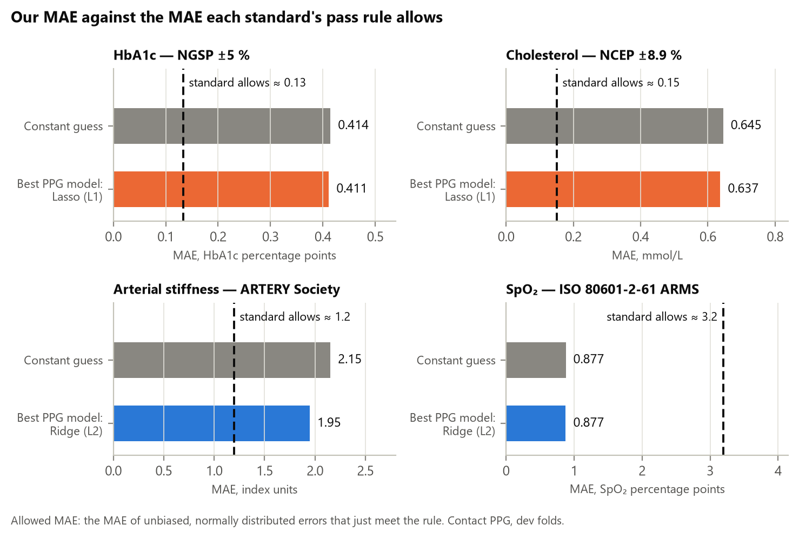

# Phase 3c — Our errors against industry and clinical accuracy standards

_Generated 2026-10-21T11:21:06+08:00 by `python -m faceai.report03c` from saved artifacts only._

Requested by the FaceAI staff: compare our MAE with industry standards. Accuracy
standards are rarely written as an MAE, so each one is applied in its own form (a
share within a tolerance, an ARMS, or a mean and SD of differences) on the same
out-of-fold predictions as `reports/03_cv_robustness.md`: **contact PPG, 5 dev folds,
479 subjects, 956 sessions. Not camera rPPG, and not the sealed test set.** The rule is
then translated into the MAE it allows, so it can sit next to ours.

## 1. Headline



- **HbA1c**: the NGSP rule allows an MAE of ≈ 0.13 percentage points; our best is 0.411 (3.1× too large), and the constant guess
  0.414. Only 51% of predictions land within ±5 % of the label, against 90 % required.
- **Cholesterol**: allowed ≈ 0.15 mmol/L; ours 0.637 (4.2×); 36% within ±8.9 % against ≈95 % required.
- **To meet either lab standard on this cohort, a model would have to explain ≈95% of the label variance. Ours explain at most
  9%.** The gap is not a tuning problem: the PPG features carry almost no information about either target (Phase 3).
- **Arterial stiffness**: SD of differences 2.87 against the ARTERY Society's 1.5 for "acceptable" (allowed MAE ≈ 1.20; ours 1.947,
  1.6×). Graded "poor" — but so is the constant, and the label is not the PWV the guideline is written for.
- **SpO₂**: ARMS 1.32, under ISO's 4.0 % and FDA's typical 3.0 %. The constant guess (1.33) is under it too: a constant's ARMS is roughly the label SD,
  which is only 1.33 on this cohort. This is not a pass.
- **On every standard, the best model and the constant guess get the same verdict.**
  So none of these comparisons is evidence that our models work, and none could
  certify anything: section 3 shows that the reference each standard assumes is not
  what our labels are.

## 2. Each standard applied in its own form

| Target | Standard: pass rule | Statistic | Constant guess [95% CI] | Best PPG model [95% CI] | Verdict (constant / model) | MAE: allowed vs ours | R²: required vs achieved |
|---|---|---|---|---|---|---|---|
| HbA1c (%) | NGSP manufacturer certification: 36 of 40 results within ±5 % of an NGSP reference laboratory | share within tolerance | 50.5% [46.0–55.0] | Lasso (L1): 50.9% [46.3–55.4] | fails / fails | 0.133 vs 0.411 | 0.95 vs 0.06 |
| Cholesterol (mmol/L) | NCEP total allowable error (CDC CRMLN): ≈95 % of results within ±8.9 % (bias ≤ 3 %, CV ≤ 3 %) | share within tolerance | 34.8% [30.6–39.5] | Lasso (L1): 36.3% [31.9–40.8] | fails / fails | 0.151 vs 0.637 | 0.95 vs 0.02 |
| SpO₂ (%) | ISO 80601-2-61 pulse oximeter accuracy: ARMS ≤ 4.0 % over SaO₂ 70–100 % (FDA 2013: ≤ 3.0 % typical) | ARMS | 1.33 [1.17–1.49] | Ridge (L2): 1.32 [1.16–1.49] | meets / meets | 3.19 vs 0.877 | -8.11 vs 0.01 |
| Arterial stiffness (index) | ARTERY Society PWV device validation: acceptable: absolute mean difference < 1.0 and SD ≤ 1.5 m/s | SD of differences | mean +0.00, SD 3.02 [2.71–3.34] | Ridge (L2): mean -0.01, SD 2.87 [2.54–3.22] | poor / poor | 1.2 vs 1.95 | 0.75 vs 0.10 |
| Respiratory rate (/min) | Brief's clinical tolerance: within ±3 breaths/min (no required share) | share within tolerance | 94.6% [93.1–95.9] | LightGBM: 95.7% [94.5–97.0] | no pass rule / no pass rule | — | — |
| Temperature (°C) | ISO 80601-2-56 laboratory accuracy: within ±0.3 °C (a bench limit for the instrument, not a patient test) | share within tolerance | 96.9% [95.4–98.2] | LightGBM: 96.9% [95.4–98.2] | no pass rule / no pass rule | — | — |

- *Verdict* applies the standard's pass rule to the number as if the test conditions
  held (they do not; section 3). RR and temperature have a tolerance but no required
  share, so they get no verdict.
- *MAE allowed*: the MAE of unbiased, normally distributed errors that just meet the
  rule (MAE = √(2/π) × SD; a rule "share p within ±w" gives SD = w / z₍₁₊ₚ₎/₂).
- *R² required*: the share of this cohort's label variance a model must explain to
  get its error SD that low. Negative means a constant already meets the rule.
- CIs resample whole subjects (2000 draws), as in Phase 3.

## 3. Why none of this certifies anything — the reference conditions

| Target | The standard assumes a reference of | Our label comes from | Label range (dev sessions) |
|---|---|---|---|
| HbA1c | NGSP Secondary Reference Laboratory | EasyTouch finger-prick analyser | 3.4–13.02 (SD 0.72) |
| Cholesterol | CDC reference method | EasyTouch finger-prick analyser | 0.9–8 (SD 0.83) |
| SpO₂ | arterial blood SaO₂ (CO-oximetry), 70–100 % | Beurer PO 60 pulse oximeter, labels 86–99 % | 86–99 (SD 1.33) |
| Arterial stiffness | carotid–femoral PWV, m/s | Eldar PPG or BPLab Angio index, unit not stated | 1.75–34.02 (SD 3.02) |
| Respiratory rate | counted breaths | physician count over one minute | 15–24 (SD 1.72) |
| Temperature | a laboratory reference source | non-contact thermometer, model not stated | 36.1–37.5 (SD 0.13) |

Every standard here is written for a measurement device checked against a better
reference, across a range that includes abnormal values. Our labels come from
consumer or point-of-care devices (named in the dataset paper, §2.1), and the cohort is
mostly young and healthy. A model trained on these labels can at best match the label
device, whose own error against the reference is unknown here. **Claims of meeting a
standard would need a new study against the reference method.** Tier C targets
(HbA1c, cholesterol, temperature) remain not clinically usable.

## 4. Targets without a device accuracy standard — the field benchmark

Age, BMI and stress (PSM-25) have no device accuracy standard. The benchmark is the
dataset paper's Table 5 (Egorov et al., ACM MM 2025). The paper's models use facial
video in 20-s windows on a different split, so this comparison is indicative only.

| Target | Paper: constant | Paper: video model | Ours: constant | Ours: best PPG model |
|---|---|---|---|---|
| HbA1c (%) | 0.43 | 0.41 | 0.414 | Lasso (L1): 0.411 |
| Cholesterol (mmol/L) | 0.66 | 0.60 | 0.645 | Lasso (L1): 0.637 |
| Respiratory rate (/min) | 1.36 | 1.20 | 1.362 | LightGBM: 1.315 |
| Arterial stiffness (index) | 2.19 | 2.04 | 2.153 | Ridge (L2): 1.947 |
| Age (years) — positive control | 5.71 | 3.91 | 5.477 | LightGBM: 2.995 |
| BMI (kg/m²) | 3.18 | 3.37 | 3.215 | Lasso (L1): 2.923 |
| Stress (PSM-25) | 1.20 | 1.07 | 1.194 | LightGBM: 1.180 |
| SpO₂ (%) | 0.98 | 0.98 | 0.877 | Ridge (L2): 0.877 |

## 5. Heart rate — the standard Phase 4 will be judged on

Heart rate is the field's headline rPPG metric. Not yet measured by us on video
(Phase 4 is blocked on the frontal-video download). The dataset paper reports an
rPPG heart-rate MAE of 3.80 bpm (POS) and 2.82 bpm (RhythmFormer) on the frontal
camera, and 16.40 and 7.33 bpm on the side camera (Table 4). Two standards are
commonly applied to heart rate, but **we have not checked either against its own
(paywalled) text**:

- ANSI/AAMI EC13 (cardiac monitors): readout error within ±10 % or ±5 bpm, whichever
  is greater — quoted from the 1987 edition in secondary sources.
- ANSI/CTA-2065 (consumer heart-rate monitors): published validation studies apply it
  as a mean absolute percentage error below 10 %.

## 6. Sources

- NGSP, Summary of Certification Criteria — https://ngsp.org/critsumm.asp (read
  2026-10-21). CAP's HbA1c grading limit is ±6 %: Rohlfing et al., *Clin Chim Acta*
  2014;433:259–263, doi:10.1016/j.cca.2014.03.034.
- CDC Cholesterol Reference Method Laboratory Network, total-cholesterol certification
  protocol (as quoted; the PDF has moved from its old cdc.gov address): NCEP bias
  ≤ 3.0 % and CV ≤ 3.0 %, implying 8.9 % total allowable error (3 + 1.96 × 3).
- FDA, *Pulse Oximeters — Premarket Notification Submissions [510(k)s]*, final
  guidance, 4 Mar 2013, Table 3 (ARMS ≤ 3.0 % typical, transmittance sensors, SpO₂
  70–100 %); it refers to ISO 80601-2-61 clause 201.12.1.101, whose 4.0 % limit is
  taken from study protocols that quote it (the ISO text is paywalled).
- Wilkinson et al., ARTERY Society guidelines Part 1: arterial pulse wave velocity,
  *Artery Research* 2010;4(2):34–40, doi:10.1016/j.artres.2010.03.001, Table 4.
- Wang et al., Infrared thermography for measuring elevated body temperature,
  *Sensors* 2022;22(1):215, doi:10.3390/s22010215 (table of ISO 80601-2-56 limits).
- Egorov et al., Gaze into the Heart, ACM MM 2025, doi:10.1145/3746027.3758255,
  arXiv:2508.17924 — label devices (§2.1), Tables 3–5.

## 7. Provenance

- **Standards (`artifacts/cv/standards.json`)** — generated 2026-10-21T11:21:00+08:00; commit `1e7e1b4` (uncommitted paths: 0); split SHA-256 `08f6fb63072e…`; db.csv blob `b6db00bc074a…`; lockfile `435869dddb54…`; inputs: `artifacts/cv/oof.parquet` 8373186ba1f6….
- **CV results (`artifacts/cv/results.json`)** — generated 2026-10-13T19:32:33+08:00; commit `ad5864c` (uncommitted paths: 0); split SHA-256 `08f6fb63072e…`; db.csv blob `b6db00bc074a…`; lockfile `435869dddb54…`; inputs: `artifacts/features/ppg_clean.parquet` 2014361e6480….

## 8. Reproduce

```
make cv          # writes artifacts/cv/oof.parquet
make standards
make report03c
```
