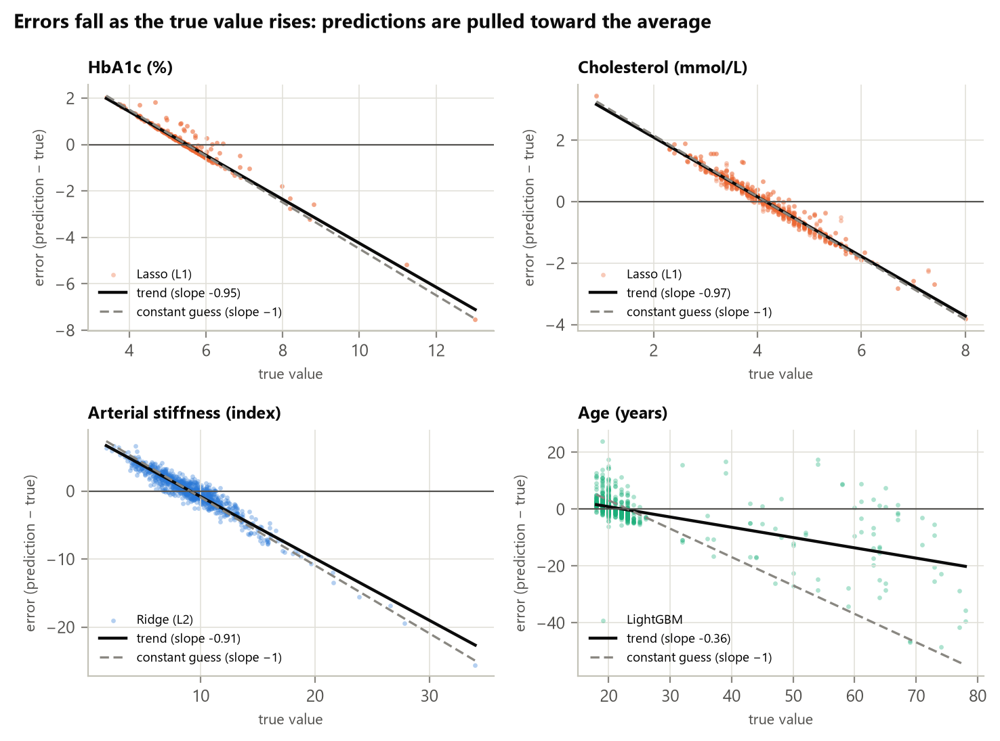

# Phase 3d — Bias in our errors, and what de-biasing can and cannot do

_Generated 2026-10-26T19:46:03+08:00 by `python -m faceai.report03d` from saved artifacts only._

Follow-up to the staff feedback on industry standards (`reports/03c_standards.md`). MAE
hides the direction of errors; standards that judge agreement (Bland–Altman, ISO
81060-2, the ARTERY Society guidelines) report bias and its spread. Same out-of-fold
predictions as Phase 3: **contact PPG, 5 dev folds, 479 subjects, 956 sessions; not camera
rPPG, not the sealed test set.** Error = prediction − true value (positive = too high).

## 1. Headline



- **No systematic bias.** For every target the best model's mean error is within ±0.3 of
  zero and its 95 % CI contains zero. Least-squares models are unbiased on average by
  construction, so MAE is not hiding an offset.
- **Strong proportional bias (regression to the mean).** Predictions stay near the cohort
  average: low true values are overestimated and high ones underestimated. The slope of
  error on the true value is −1 for a constant guess and 0 for a perfect model; our best
  models score -0.95 for HbA1c and -0.97 for cholesterol — they follow
  only 3–5 % of real differences. In the top 10 % of HbA1c (≥ 5.99 %)
  predictions are 1.04 points too low on average, which is why no prediction ever
  reaches the 6.5 % diabetes cut-off (Phase 3b). Age is the only target whose predictions
  follow most of the real differences (slope -0.36), yet it still underestimates the oldest
  10 % (≥ 24 years in this young cohort) by 9.1 years.
- **Subgroup bias follows from it.** Groups whose average differs from the cohort's
  inherit the pull to the mean: the HbA1c error averages +0.07 for women and -0.15 for men;
  SpO₂ is overestimated by 0.72 points in people aged ≥ 25 — the risky direction for
  oximetry, because it hides low oxygen; respiratory rate is +1.0/min at rest and -1.0/min after exercise.
- **De-biasing cannot add information.** Subtracting an average offset changes nothing.
  Stretching predictions to undo the slope (fitted on training subjects only) removes the
  proportional bias but multiplies the noise: MAE rises for every target where it can be
  applied — age 2.99 → 3.85 years, while the oldest 10 % go from -9.1 to -1.4 years.
  It is a fairness trade-off for a model with signal, and pointless for one without.
- **Beware 'bias-corrected' results that use the true value.** The correction some
  brain-age papers report puts the test label back into the prediction. Here it would cut
  HbA1c MAE from 0.411 to 0.073 — a number no deployed model could reach.
  When comparing with a published benchmark, check which correction it used.

## 2. Systematic bias and limits of agreement (best PPG model per target)

| Target | Model | Mean error [95 % CI] | 95 % limits of agreement | MAE |
|---|---|---|---|---|
| HbA1c (%) | Lasso (L1) | -0.001 [-0.067, +0.057] | -1.38 to +1.38 | 0.411 |
| Cholesterol (mmol/L) | Lasso (L1) | +0.000 [-0.072, +0.070] | -1.61 to +1.61 | 0.637 |
| SpO₂ (%) | Ridge (L2) | +0.000 [-0.094, +0.101] | -2.58 to +2.58 | 0.877 |
| Stress (PSM-25) | LightGBM | +0.007 [-0.118, +0.135] | -2.86 to +2.87 | 1.180 |
| Temperature (°C) | LightGBM | +0.000 [-0.011, +0.012] | -0.26 to +0.26 | 0.099 |
| Respiratory rate (/min) | LightGBM | -0.009 [-0.103, +0.085] | -3.20 to +3.18 | 1.315 |
| Arterial stiffness (index) | Ridge (L2) | +0.009 [-0.197, +0.196] | -5.61 to +5.63 | 1.947 |
| BMI (kg/m²) | Lasso (L1) | +0.005 [-0.339, +0.345] | -7.69 to +7.70 | 2.923 |
| Age (years) | LightGBM | -0.270 [-0.816, +0.240] | -12.36 to +11.82 | 2.995 |

Limits of agreement = mean ± 1.96 SD of the errors: 95 % of single predictions fall inside
them. They are what a Bland–Altman comparison with a reference method reports.

## 3. Proportional bias (regression to the mean)

| Target | Model | Slope of error on true value [95 % CI] | Mean error, lowest 10% | Mean error, highest 10% |
|---|---|---|---|---|
| HbA1c | Mean | -1.00 [-1.00, -1.00] | ≤ 4.82: +1.11 | ≥ 5.99: -1.19 |
| HbA1c | Demographics | -0.86 [-0.91, -0.80] | ≤ 4.82: +1.03 | ≥ 5.99: -0.87 |
| HbA1c | Lasso (L1) | -0.95 [-0.98, -0.90] | ≤ 4.82: +1.09 | ≥ 5.99: -1.04 |
| Cholesterol | Mean | -1.00 [-1.01, -1.00] | ≤ 3.28: +1.29 | ≥ 5.22: -1.62 |
| Cholesterol | Demographics | -0.94 [-0.98, -0.91] | ≤ 3.28: +1.26 | ≥ 5.22: -1.49 |
| Cholesterol | Lasso (L1) | -0.97 [-0.99, -0.94] | ≤ 3.28: +1.28 | ≥ 5.22: -1.54 |
| SpO₂ | Mean | -1.00 [-1.00, -1.00] | ≤ 96: +3.02 | ≥ 99: -0.99 |
| SpO₂ | Demographics | -0.94 [-0.97, -0.90] | ≤ 96: +2.75 | ≥ 99: -0.93 |
| SpO₂ | Ridge (L2) | -0.99 [-1.00, -0.99] | ≤ 96: +2.99 | ≥ 99: -0.98 |
| Stress | Mean | -1.00 [-1.00, -1.00] | ≤ 1: +2.04 | ≥ 5: -2.61 |
| Stress | Demographics | -0.95 [-0.97, -0.94] | ≤ 1: +1.98 | ≥ 5: -2.53 |
| Stress | LightGBM | -0.97 [-0.98, -0.96] | ≤ 1: +1.99 | ≥ 5: -2.55 |
| Temperature | Mean | -1.00 [-1.00, -1.00] | ≤ 36.4: +0.22 | ≥ 36.7: -0.17 |
| Temperature | Demographics | -1.00 [-1.00, -0.99] | ≤ 36.4: +0.22 | ≥ 36.7: -0.17 |
| Temperature | LightGBM | -1.00 [-1.00, -0.99] | ≤ 36.4: +0.22 | ≥ 36.7: -0.17 |
| Respiratory rate | Mean | -1.00 [-1.00, -1.00] | ≤ 16: +2.12 | ≥ 20: -2.56 |
| Respiratory rate | Demographics | -1.00 [-1.00, -0.99] | ≤ 16: +2.12 | ≥ 20: -2.54 |
| Respiratory rate | LightGBM | -0.88 [-0.90, -0.86] | ≤ 16: +1.88 | ≥ 20: -2.24 |
| Arterial stiffness | Mean | -1.00 [-1.00, -1.00] | ≤ 5.715: +4.46 | ≥ 12.34: -6.08 |
| Arterial stiffness | Demographics | -0.98 [-0.99, -0.96] | ≤ 5.715: +4.46 | ≥ 12.34: -5.97 |
| Arterial stiffness | Ridge (L2) | -0.91 [-0.93, -0.88] | ≤ 5.715: +3.84 | ≥ 12.34: -5.73 |
| BMI | Mean | -1.00 [-1.00, -1.00] | ≤ 18.36: +5.13 | ≥ 28.67: -9.06 |
| BMI | Demographics | -0.84 [-0.89, -0.80] | ≤ 18.36: +4.22 | ≥ 28.67: -7.62 |
| BMI | Lasso (L1) | -0.84 [-0.89, -0.79] | ≤ 18.36: +4.15 | ≥ 28.67: -7.62 |
| Age | Mean | -1.00 [-1.00, -1.00] | ≤ 19: +4.34 | ≥ 24: -24.24 |
| Age | Demographics | -0.89 [-0.92, -0.85] | ≤ 19: +3.89 | ≥ 24: -20.89 |
| Age | LightGBM | -0.36 [-0.47, -0.24] | ≤ 19: +1.84 | ≥ 24: -9.11 |

A constant guess has slope −1 by construction (its error is the average minus the truth).

## 4. Subgroup bias (best PPG model; groups whose 95 % CI excludes zero)

| Target | Model | Factor | Group | Subjects | Mean error [95 % CI] |
|---|---|---|---|---|---|
| HbA1c | Lasso (L1) | sex | F | 320 | +0.071 [+0.008, +0.133] |
| HbA1c | Lasso (L1) | sex | M | 161 | -0.146 [-0.292, -0.025] |
| SpO₂ | Ridge (L2) | sex | M | 161 | +0.199 [+0.033, +0.371] |
| SpO₂ | Ridge (L2) | age band | >= 25 | 44 | +0.721 [+0.279, +1.169] |
| SpO₂ | Ridge (L2) | state | rest | 479 | -0.109 [-0.216, -0.002] |
| Respiratory rate | LightGBM | state | post-exercise | 477 | -1.016 [-1.142, -0.895] |
| Respiratory rate | LightGBM | state | rest | 479 | +0.993 [+0.888, +1.095] |
| Age | LightGBM | age band | < 25 | 435 | +0.777 [+0.532, +1.024] |
| Age | LightGBM | age band | >= 25 | 44 | -10.598 [-14.849, -6.371] |

- The age bands are defined by age itself, so the age row (-10.6 years for ≥ 25) is
  the proportional bias of section 3 seen again, not a separate effect.
- Only 44 dev subjects are aged ≥ 25; their intervals are wide.

## 5. De-biasing, done without the test labels

| Target | Model | MAE as fitted | Offset removed | Slope undone | Uses test label (invalid) |
|---|---|---|---|---|---|
| HbA1c | Lasso (L1) | 0.411 (slope -0.95; top 10 % -1.04) | 0.411 | 0.884 (applied in 3/5 folds) | 0.073 |
| Cholesterol | Lasso (L1) | 0.637 (slope -0.97; top 10 % -1.54) | 0.637 | 1.000 (applied in 1/5 folds) | 0.099 |
| SpO₂ | Ridge (L2) | 0.877 (slope -0.99; top 10 % -0.98) | 0.877 | not applied: no signal to stretch | 0.030 |
| Stress | LightGBM | 1.180 (slope -0.97; top 10 % -2.55) | 1.180 | not applied: no signal to stretch | 0.188 |
| Temperature | LightGBM | 0.099 (slope -1.00; top 10 % -0.17) | 0.099 | not applied: no signal to stretch | 0.009 |
| Respiratory rate | LightGBM | 1.315 (slope -0.88; top 10 % -2.24) | 1.316 | 3.877 (slope -0.01; top 10 % +0.20) | 0.469 |
| Arterial stiffness | Ridge (L2) | 1.947 (slope -0.91; top 10 % -5.73) | 1.947 | 7.691 (slope +0.11; top 10 % -1.76) | 0.650 |
| BMI | Lasso (L1) | 2.923 (slope -0.84; top 10 % -7.62) | 2.925 | 6.907 (slope +0.00; top 10 % -0.02) | 1.212 |
| Age | LightGBM | 2.995 (slope -0.36; top 10 % -9.11) | 3.010 | 3.846 (slope -0.05; top 10 % -1.42) | 2.568 |

- **How it was fitted.** In each outer fold the model was refitted, with that fold's tuned
  hyperparameters, on 5 inner folds of the training subjects; the inner out-of-fold
  predictions set the correction, applied to the untouched outer fold.
- **Slope undone** inverts prediction = a + b·truth. Where b ≤ 0.05 (the model follows less
  than 5 % of real differences) the inverse would multiply the noise more than twentyfold,
  so the fold is left as fitted.
- **Uses test label** subtracts the expected error at the person's *true* value. It needs the
  answer, so it cannot be used — it is shown only to calibrate claims made elsewhere.

## 6. What we take from this

1. Report bias and limits of agreement next to every MAE; it is the form device standards use.
2. Our weak targets (HbA1c, cholesterol, SpO₂, stress, temperature) do not have a bias problem
   that a correction can fix — they have no signal. Undoing their slope is either impossible
   (nothing to stretch) or makes them worse (HbA1c, cholesterol).
3. For age, a slope correction would trade overall accuracy for less underestimation of
   older people. If the team cares about older users, report both numbers and decide openly.
4. Any benchmark quoted as 'bias-corrected' must say whether the correction used the true
   value. If it did, it is not comparable with ours.

## 7. Provenance

- **Bias (`artifacts/cv/bias.json`)** — generated 2026-10-26T19:45:55+08:00; commit `a901700` (uncommitted paths: 0); split SHA-256 `08f6fb63072e…`; db.csv blob `b6db00bc074a…`; lockfile `435869dddb54…`; inputs: `artifacts/cv/oof.parquet` 8373186ba1f6…, `artifacts/cv/folds.csv` b9763f58510d….

## 8. Reproduce

```
make cv     # writes artifacts/cv/oof.parquet and folds.csv
make bias
make report03d
```
