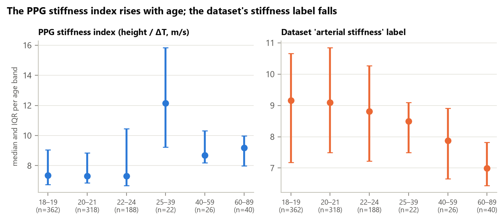
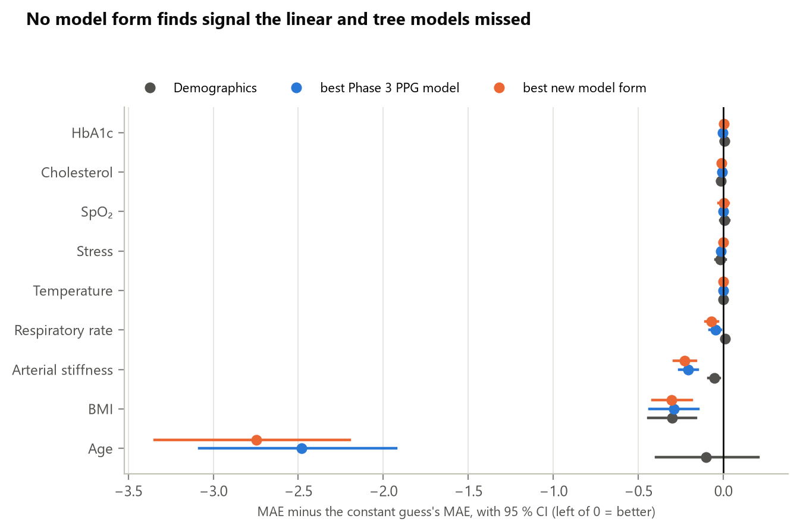
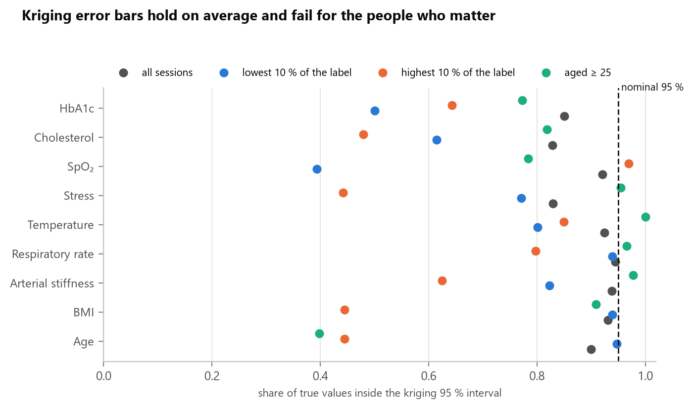
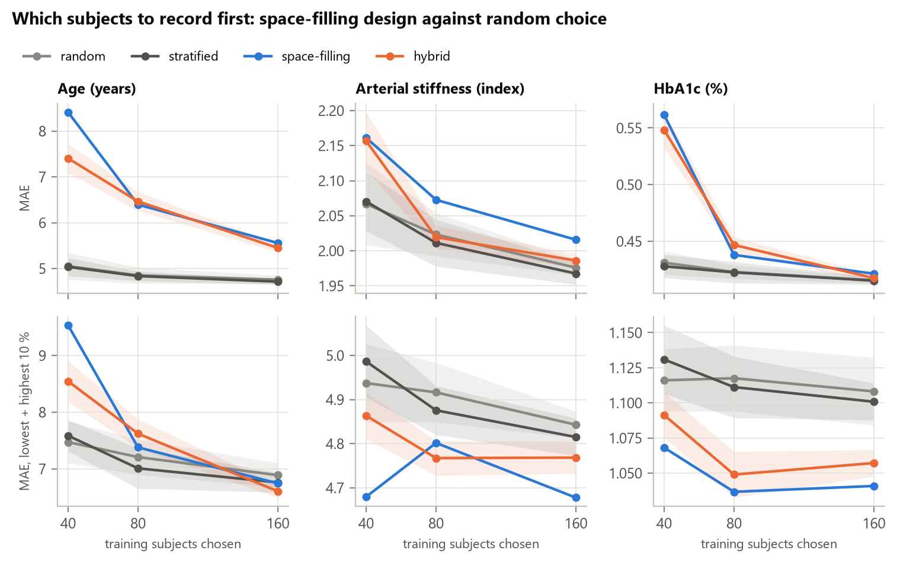
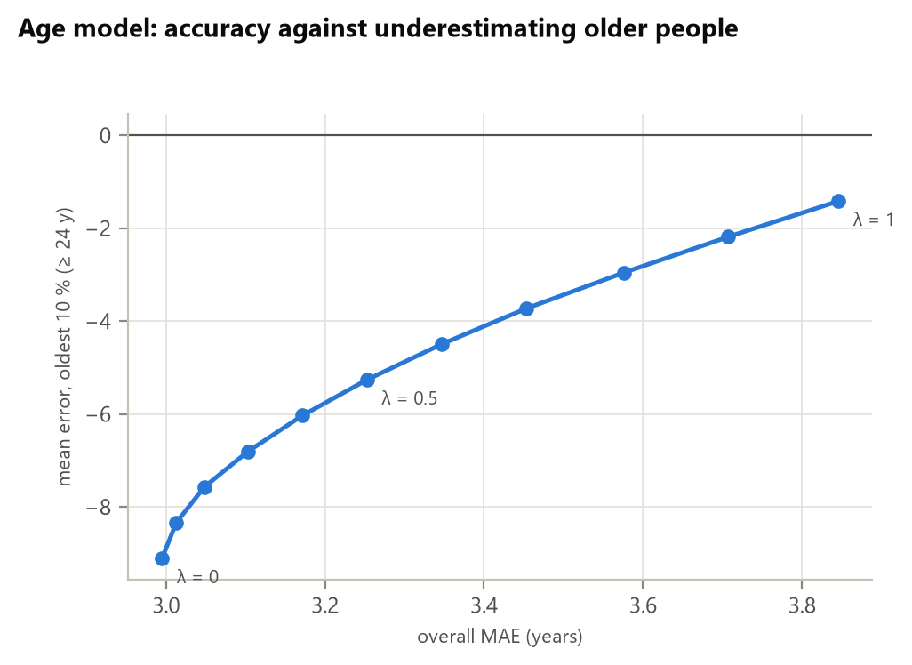

# Phase 3e — Surrogate-modelling lessons applied to FaceAI

_Generated 2026-10-27T20:20:30+08:00 by `python -m faceai.report03e` from saved artifacts only._

Source material: the MoSPSyDe group's meeting materials (NTU School of Chemistry,
Chemical Engineering and Biotechnology) — Maaz Ahmad, *Basics of Surrogate Modeling*
(7 Oct 2026); K. Matsunami, *Introduction to Population Balance Modeling* (25 Jul 2025);
K. Matsunami, group-meeting slides (7 Oct 2026). Every test below uses the same contact-PPG
dev folds as Phase 3 (479 subjects, 956 sessions); the held-out test set is not read.

## 0. What each idea became

| Idea from the material | Where | What we did here | Section |
|---|---|---|---|
| White-, gray- and black-box models; hybrid models | Ahmad p. 2 | Built the mechanistic PPG stiffness index (height / ΔT) and tested the stiffness label against it | 1 |
| Model form must be flexible enough; the list of surrogate techniques | Ahmad pp. 6, 14 | Kriging, RBF-SVR, kNN and a neural net through the same nested CV | 2 |
| Validation metrics beyond MAE | Ahmad p. 13 | Median, R², 95th-percentile and maximum absolute error for every model | 2 |
| Multiple-start learning | Ahmad p. 7 | Kriging likelihood fitted from 4 starting points | 2 |
| Kriging's own variance; parameter uncertainty | Ahmad p. 9; Matsunami lecture slide 20 | Calibrated kriging 95 % intervals, checked overall and in the extremes | 3 |
| Data must be system-informative; adaptive sampling (explore vs exploit); DoE | Ahmad pp. 5, 15; group slides (DoE) | Space-filling (Kennard–Stone) choice of which videos to download first, simulated | 4 |
| Process optimisation on a Pareto front | Matsunami lecture slide 20 | Accuracy against older-people bias for the age model | 5 |
| Dynamic models (ARX, RNN/LSTM/GRU, state-space, neural ODE) | Ahmad p. 14 | Not run: our inputs are per-session summaries. Candidates for the raw-waveform track (Phase 8) | 6 |
| Bayesian hyperparameter search | Ahmad p. 10 | Not needed yet: our grids are small; noted for the deep models | 6 |
| Population balance modelling (distributed properties, birth/death terms) | Matsunami lecture | No direct transfer — it models particle populations. Its idea of predicting a *distribution* is what section 3 tests | 6 |

## 1. Gray-box: a mechanistic stiffness index exposes the stiffness label



The digital-volume-pulse stiffness index (Millasseau et al., *Clin Sci* 2002;103:371–377,
doi:10.1042/cs1030371) is height divided by ΔT, the time from the pulse's systolic peak to
its diastolic peak or inflection. Stiffer arteries return the reflected wave sooner, so SI
rises with age. We read ΔT from every session's ensemble beat (618 with a diastolic
peak, 337 with an inflection, 1 without). The figure's n counts sessions (two per
subject); the statistics below resample whole subjects.

| Check (Spearman ρ, subject-cluster 95 % CI) | Result |
|---|---|
| ΔT vs height (must be positive: a longer path) | +0.33 [+0.25, +0.41] |
| ΔT vs age (must be negative: stiffer with age) | -0.11 [-0.19, -0.02] |
| PPG stiffness index vs age | +0.12 [+0.03, +0.19] |
| **Stiffness label vs age** | **-0.12 [-0.19, -0.05]** |
| **Stiffness label, aged ≥ 25 minus younger** | **-1.47 [-1.96, -0.97]** |
| Stiffness label vs heart rate | +0.41 [+0.35, +0.46] |
| Stiffness label vs PPG stiffness index | -0.01 [-0.07, +0.06] |
| Rest → exercise: label change vs heart-rate change | +0.15 [+0.06, +0.25] |
| Rest → exercise: label change vs SI change | +0.01 [-0.09, +0.10] |

- **ΔT and SI behave like physiology** — ΔT lengthens with height and shortens with age.
- **The dataset's 'arterial stiffness' label does not.** It is *lower* in older subjects,
  rises with heart rate, and is unrelated to the PPG stiffness index. Arterial stiffness
  increases with age, so whatever the label measures, it is not behaving as arterial
  stiffness in this cohort. The dataset paper says the label came from either an Eldar
  photoplethysmograph or a BPLab Angio sphygmography system, with no unit; mixing two
  devices, or a heart-rate-dependent index, would explain this. **Not claimed: which one.**
- **Consequence:** Phase 3's 'stiffness' models mostly learn heart rate (as the Phase 3b
  explanations already found). Adding ΔT and SI to them changes nothing (all four MAE
  changes have CIs spanning zero). The stiffness target should be confirmed with the
  dataset authors before more modelling effort goes into it.

## 2. Model form: no technique finds signal the others missed



- **HbA1c, cholesterol, SpO₂, stress:** none of the 8 model forms beats the constant guess.
  Kriging is *worse* than the constant on all four: with almost no signal, its flexible fit
  follows noise. The null result is the data, not the model form.
- **Temperature:** SVR edges the *mean* guess (0.097), but the *median* guess is better still
  (0.091): SVR's ε-insensitive loss behaves like a median fit. No real signal.
- **Age (positive control):** 5 forms pass the strict rule (LightGBM, Kriging (GP), SVR (RBF), kNN, Neural net (MLP)).
  kNN has the lowest MAE (2.73 years, -0.266 vs LightGBM [-0.512, -0.005]) —
  but it is *worse* for people aged ≥ 25 (15.3 vs 13.6 years). A lower MAE is
  not a better model for the people who matter; see section 5.
- **Worst cases (Ahmad p. 13):** every age model's maximum error is 49–58 years. For the
  LightGBM model it is a 74-year-old predicted as 25. MAE alone hides this; report the maximum too.

| Target | Model | MAE [95 % CI] | vs constant [95 % CI] | Median AE | R² | 95th pct AE | Max AE | Beats both (strict) |
|---|---|---|---|---|---|---|---|---|
| HbA1c | Mean | 0.414 [0.365, 0.468] | — | 0.275 | -0.00 | 1.27 | 7.54 |  |
| HbA1c | Demographics | 0.422 [0.377, 0.469] | +0.008 [-0.014, +0.030] | 0.295 | +0.12 | 1.25 | 6.99 |  |
| HbA1c | Ridge (L2) | 0.414 [0.367, 0.467] | -0.001 [-0.012, +0.010] | 0.283 | +0.06 | 1.23 | 7.33 |  |
| HbA1c | Lasso (L1) | 0.411 [0.363, 0.464] | -0.003 [-0.016, +0.010] | 0.273 | +0.06 | 1.22 | 7.54 |  |
| HbA1c | LightGBM | 0.413 [0.368, 0.463] | -0.002 [-0.017, +0.014] | 0.283 | +0.09 | 1.21 | 7.40 |  |
| HbA1c | Kriging (GP) | 0.488 [0.432, 0.549] | +0.074 [+0.051, +0.098] | 0.304 | -0.26 | 1.46 | 7.54 |  |
| HbA1c | SVR (RBF) | 0.419 [0.370, 0.473] | +0.004 [-0.008, +0.018] | 0.290 | +0.04 | 1.22 | 7.34 |  |
| HbA1c | kNN | 0.422 [0.374, 0.475] | +0.008 [-0.007, +0.024] | 0.298 | +0.08 | 1.22 | 7.24 |  |
| HbA1c | Neural net (MLP) | 0.450 [0.406, 0.501] | +0.036 [+0.011, +0.061] | 0.322 | +0.05 | 1.34 | 6.64 |  |
| Cholesterol | Mean | 0.645 [0.600, 0.692] | — | 0.534 | -0.01 | 1.54 | 3.87 |  |
| Cholesterol | Demographics | 0.630 [0.585, 0.678] | -0.015 [-0.034, +0.004] | 0.521 | +0.04 | 1.57 | 3.55 |  |
| Cholesterol | Ridge (L2) | 0.641 [0.596, 0.690] | -0.005 [-0.017, +0.007] | 0.519 | +0.02 | 1.55 | 3.76 |  |
| Cholesterol | Lasso (L1) | 0.637 [0.593, 0.686] | -0.009 [-0.022, +0.006] | 0.515 | +0.02 | 1.56 | 3.82 |  |
| Cholesterol | LightGBM | 0.640 [0.593, 0.687] | -0.006 [-0.016, +0.004] | 0.513 | +0.01 | 1.53 | 3.74 |  |
| Cholesterol | Kriging (GP) | 0.704 [0.653, 0.759] | +0.059 [+0.032, +0.089] | 0.573 | -0.19 | 1.68 | 3.87 |  |
| Cholesterol | SVR (RBF) | 0.634 [0.587, 0.682] | -0.011 [-0.026, +0.004] | 0.502 | +0.01 | 1.57 | 3.89 |  |
| Cholesterol | kNN | 0.641 [0.597, 0.692] | -0.004 [-0.013, +0.005] | 0.517 | +0.00 | 1.58 | 3.73 |  |
| Cholesterol | Neural net (MLP) | 0.653 [0.607, 0.700] | +0.007 [-0.014, +0.027] | 0.513 | -0.02 | 1.62 | 3.59 |  |
| SpO₂ | Mean | 0.877 [0.809, 0.949] | — | 0.990 | -0.00 | 3.00 | 12.03 |  |
| SpO₂ | Demographics | 0.885 [0.825, 0.951] | +0.008 [-0.019, +0.035] | 0.809 | +0.06 | 2.23 | 12.27 |  |
| SpO₂ | Ridge (L2) | 0.877 [0.811, 0.949] | -0.000 [-0.003, +0.003] | 0.967 | +0.01 | 2.87 | 12.09 |  |
| SpO₂ | Lasso (L1) | 0.880 [0.817, 0.948] | +0.003 [-0.019, +0.024] | 0.875 | +0.05 | 2.31 | 12.26 |  |
| SpO₂ | LightGBM | 0.881 [0.816, 0.950] | +0.004 [-0.012, +0.018] | 0.903 | +0.04 | 2.34 | 12.16 |  |
| SpO₂ | Kriging (GP) | 0.964 [0.895, 1.039] | +0.086 [+0.057, +0.118] | 0.902 | -0.14 | 3.01 | 12.46 |  |
| SpO₂ | SVR (RBF) | 0.879 [0.806, 0.954] | +0.001 [-0.030, +0.032] | 0.658 | -0.03 | 2.82 | 12.64 |  |
| SpO₂ | kNN | 0.892 [0.824, 0.963] | +0.015 [-0.000, +0.031] | 0.825 | +0.03 | 2.54 | 12.28 |  |
| SpO₂ | Neural net (MLP) | 0.910 [0.850, 0.976] | +0.033 [+0.004, +0.061] | 0.785 | +0.02 | 2.50 | 12.37 |  |
| Stress | Mean | 1.194 [1.117, 1.271] | — | 1.042 | -0.00 | 2.93 | 4.51 |  |
| Stress | Demographics | 1.177 [1.102, 1.256] | -0.017 [-0.045, +0.012] | 0.848 | +0.04 | 2.73 | 4.28 |  |
| Stress | Ridge (L2) | 1.189 [1.114, 1.263] | -0.004 [-0.020, +0.011] | 0.999 | +0.02 | 2.73 | 4.50 |  |
| Stress | Lasso (L1) | 1.180 [1.105, 1.257] | -0.014 [-0.034, +0.007] | 0.875 | +0.04 | 2.80 | 4.34 |  |
| Stress | LightGBM | 1.180 [1.104, 1.260] | -0.014 [-0.032, +0.006] | 0.953 | +0.03 | 2.77 | 4.30 |  |
| Stress | Kriging (GP) | 1.279 [1.187, 1.371] | +0.085 [+0.038, +0.135] | 1.043 | -0.17 | 3.04 | 6.16 |  |
| Stress | SVR (RBF) | 1.199 [1.124, 1.278] | +0.006 [-0.028, +0.038] | 0.984 | +0.01 | 2.85 | 4.53 |  |
| Stress | kNN | 1.192 [1.114, 1.269] | -0.002 [-0.022, +0.018] | 0.992 | +0.02 | 2.70 | 4.35 |  |
| Stress | Neural net (MLP) | 1.220 [1.141, 1.298] | +0.026 [-0.011, +0.063] | 1.028 | -0.03 | 2.92 | 4.94 |  |
| Temperature | Mean | 0.099 [0.092, 0.107] | — | 0.063 | -0.00 | 0.26 | 0.94 |  |
| Temperature | Demographics | 0.099 [0.092, 0.107] | +0.000 [-0.001, +0.001] | 0.063 | -0.00 | 0.27 | 0.94 |  |
| Temperature | Ridge (L2) | 0.099 [0.092, 0.107] | -0.000 [-0.001, +0.001] | 0.061 | +0.00 | 0.26 | 0.94 |  |
| Temperature | Lasso (L1) | 0.099 [0.092, 0.107] | +0.000 [-0.000, +0.001] | 0.063 | -0.00 | 0.26 | 0.94 |  |
| Temperature | LightGBM | 0.099 [0.092, 0.107] | -0.000 [-0.001, +0.001] | 0.063 | -0.00 | 0.27 | 0.94 |  |
| Temperature | Kriging (GP) | 0.108 [0.099, 0.116] | +0.008 [+0.004, +0.013] | 0.065 | -0.27 | 0.27 | 1.04 |  |
| Temperature | SVR (RBF) | 0.097 [0.089, 0.105] | -0.002 [-0.004, -0.000] | 0.081 | -0.05 | 0.29 | 0.91 |  |
| Temperature | kNN | 0.101 [0.094, 0.108] | +0.002 [+0.000, +0.003] | 0.065 | -0.03 | 0.27 | 0.94 |  |
| Temperature | Neural net (MLP) | 0.103 [0.096, 0.110] | +0.004 [+0.002, +0.006] | 0.075 | -0.09 | 0.28 | 0.96 |  |
| Respiratory rate | Mean | 1.362 [1.303, 1.421] | — | 1.064 | -0.00 | 3.05 | 5.95 |  |
| Respiratory rate | Demographics | 1.373 [1.316, 1.430] | +0.011 [+0.003, +0.020] | 1.119 | -0.00 | 3.05 | 5.97 |  |
| Respiratory rate | Ridge (L2) | 1.321 [1.269, 1.377] | -0.041 [-0.072, -0.011] | 1.208 | +0.09 | 2.94 | 5.98 |  |
| Respiratory rate | Lasso (L1) | 1.324 [1.272, 1.382] | -0.038 [-0.069, -0.006] | 1.211 | +0.08 | 2.96 | 6.66 |  |
| Respiratory rate | LightGBM | 1.315 [1.260, 1.369] | -0.047 [-0.080, -0.014] | 1.207 | +0.10 | 2.88 | 5.90 |  |
| Respiratory rate | Kriging (GP) | 1.292 [1.235, 1.347] | -0.070 [-0.106, -0.032] | 1.155 | +0.12 | 3.06 | 5.47 |  |
| Respiratory rate | SVR (RBF) | 1.312 [1.256, 1.367] | -0.050 [-0.087, -0.017] | 1.210 | +0.11 | 2.91 | 5.68 |  |
| Respiratory rate | kNN | 1.331 [1.278, 1.386] | -0.031 [-0.052, -0.010] | 1.300 | +0.08 | 2.91 | 6.06 |  |
| Respiratory rate | Neural net (MLP) | 1.324 [1.269, 1.382] | -0.038 [-0.079, +0.004] | 1.185 | +0.07 | 3.06 | 6.52 |  |
| Arterial stiffness | Mean | 2.153 [2.017, 2.298] | — | 1.664 | -0.00 | 5.54 | 24.96 |  |
| Arterial stiffness | Demographics | 2.099 [1.950, 2.257] | -0.054 [-0.088, -0.021] | 1.555 | +0.02 | 5.44 | 24.92 |  |
| Arterial stiffness | Ridge (L2) | 1.947 [1.808, 2.097] | -0.206 [-0.260, -0.151] | 1.378 | +0.10 | 5.46 | 25.59 |  |
| Arterial stiffness | Lasso (L1) | 1.951 [1.818, 2.104] | -0.202 [-0.261, -0.149] | 1.384 | +0.09 | 5.43 | 25.71 |  |
| Arterial stiffness | LightGBM | 1.972 [1.836, 2.120] | -0.181 [-0.233, -0.128] | 1.375 | +0.08 | 5.36 | 25.56 |  |
| Arterial stiffness | Kriging (GP) | 2.118 [1.978, 2.262] | -0.035 [-0.103, +0.038] | 1.546 | +0.00 | 5.47 | 26.19 |  |
| Arterial stiffness | SVR (RBF) | 1.926 [1.784, 2.079] | -0.226 [-0.290, -0.162] | 1.350 | +0.08 | 5.59 | 26.46 |  |
| Arterial stiffness | kNN | 2.007 [1.869, 2.150] | -0.146 [-0.198, -0.095] | 1.465 | +0.08 | 5.63 | 25.80 |  |
| Arterial stiffness | Neural net (MLP) | 2.134 [1.997, 2.293] | -0.019 [-0.093, +0.058] | 1.552 | -0.02 | 5.66 | 25.95 |  |
| BMI | Mean | 3.215 [2.974, 3.466] | — | 2.777 | -0.01 | 7.87 | 21.98 |  |
| BMI | Demographics | 2.912 [2.685, 3.150] | -0.303 [-0.443, -0.163] | 2.401 | +0.14 | 7.51 | 23.06 |  |
| BMI | Ridge (L2) | 2.925 [2.701, 3.176] | -0.290 [-0.425, -0.141] | 2.413 | +0.13 | 7.52 | 22.99 |  |
| BMI | Lasso (L1) | 2.923 [2.703, 3.171] | -0.292 [-0.436, -0.146] | 2.391 | +0.13 | 7.39 | 23.03 |  |
| BMI | LightGBM | 2.932 [2.712, 3.163] | -0.283 [-0.412, -0.155] | 2.407 | +0.13 | 7.51 | 22.90 |  |
| BMI | Kriging (GP) | 2.988 [2.762, 3.225] | -0.227 [-0.370, -0.088] | 2.418 | +0.10 | 7.65 | 22.84 |  |
| BMI | SVR (RBF) | 2.911 [2.664, 3.155] | -0.304 [-0.418, -0.187] | 2.224 | +0.11 | 7.74 | 23.78 |  |
| BMI | kNN | 3.004 [2.765, 3.243] | -0.211 [-0.303, -0.112] | 2.431 | +0.09 | 7.94 | 23.84 |  |
| BMI | Neural net (MLP) | 3.046 [2.815, 3.283] | -0.168 [-0.317, -0.015] | 2.410 | +0.06 | 7.69 | 23.44 |  |
| Age | Mean | 5.477 [4.667, 6.336] | — | 3.291 | -0.00 | 29.33 | 54.96 |  |
| Age | Demographics | 5.376 [4.657, 6.128] | -0.101 [-0.396, +0.205] | 2.696 | +0.10 | 24.08 | 52.77 |  |
| Age | Ridge (L2) | 4.662 [4.095, 5.300] | -0.815 [-1.257, -0.395] | 2.694 | +0.42 | 17.26 | 53.62 |  |
| Age | Lasso (L1) | 4.568 [4.003, 5.217] | -0.909 [-1.336, -0.503] | 2.510 | +0.38 | 18.77 | 52.00 |  |
| Age | LightGBM | 2.995 [2.548, 3.492] | -2.482 [-3.083, -1.923] | 1.390 | +0.67 | 11.75 | 48.58 | yes |
| Age | Kriging (GP) | 3.381 [2.879, 3.948] | -2.096 [-2.658, -1.617] | 1.484 | +0.55 | 14.01 | 53.86 | yes |
| Age | SVR (RBF) | 2.925 [2.432, 3.475] | -2.552 [-3.112, -2.020] | 1.414 | +0.62 | 10.81 | 51.93 | yes |
| Age | kNN | 2.729 [2.226, 3.273] | -2.748 [-3.344, -2.198] | 1.200 | +0.60 | 10.78 | 57.60 | yes |
| Age | Neural net (MLP) | 3.227 [2.781, 3.727] | -2.249 [-2.904, -1.655] | 1.571 | +0.63 | 11.34 | 53.70 | yes |

## 3. Kriging uncertainty: right on average, wrong where it matters



Each kriging prediction carries a standard deviation, calibrated on the training subjects
only (closed-form leave-one-out residuals; scale factors by fold are in the JSON).

| Target | Coverage, all | Lowest 10 % | Highest 10 % | Aged ≥ 25 | Mean half-width | SD vs |error| (ρ, 95 % CI) |
|---|---|---|---|---|---|---|
| HbA1c | 0.85 | 0.50 | 0.64 | 0.77 | ±1.08 | -0.07 [-0.16, +0.02] |
| Cholesterol | 0.83 | 0.61 | 0.48 | 0.82 | ±1.33 | -0.10 [-0.18, -0.01] |
| SpO₂ | 0.92 | 0.39 | 0.97 | 0.78 | ±2.55 | -0.03 [-0.10, +0.04] |
| Stress | 0.83 | 0.77 | 0.44 | 0.95 | ±2.15 | -0.09 [-0.18, +0.00] |
| Temperature | 0.92 | 0.80 | 0.85 | 1.00 | ±0.27 | -0.07 [-0.15, +0.01] |
| Respiratory rate | 0.94 | 0.94 | 0.80 | 0.97 | ±2.98 | +0.02 [-0.04, +0.08] |
| Arterial stiffness | 0.94 | 0.82 | 0.62 | 0.98 | ±5.19 | +0.06 [-0.01, +0.13] |
| BMI | 0.93 | 0.94 | 0.44 | 0.91 | ±7.03 | +0.11 [+0.02, +0.19] |
| Age | 0.90 | 0.95 | 0.44 | 0.40 | ±6.39 | +0.42 [+0.35, +0.49] |

- **SpO₂:** only 39% of the lowest-saturation sessions fall inside their 95 % interval.
  **Age:** only 40% of people aged ≥ 25.
- The interval width does not track the error for the weak targets (ρ ≈ 0): the model
  cannot tell that a person is extreme from inputs that look ordinary. Only for age
  (ρ +0.42) does the uncertainty carry information.
- This is the general form of the confidence-check failure on subject 4504: an input-based
  confidence score cannot flag a person whose *label* is extreme. A safe app should state
  the label range the model was trained on and refuse to reassure outside it.

## 4. Design of experiments: which videos to download first



Phase 4 needs the frontal video (58.18 GB). Labels are already on disk, so the subjects can
be chosen by design. Ridge models trained on n chosen subjects, scored on the untouched
fold (mean ± SD over 20 draws; space-filling is deterministic). Tail = lowest + highest
10 % of each label.

| Target | n | MAE random | MAE stratified | MAE space-filling | MAE hybrid | tail random | tail stratified | tail space-filling | tail hybrid |
|---|---|---|---|---|---|---|---|---|---|
| Age | 40 | 5.052 ± 0.292 | 5.037 ± 0.198 | 8.412 | 7.405 ± 0.317 | 7.47 | 7.59 | 9.53 | 8.55 |
| Age | 80 | 4.852 ± 0.178 | 4.836 ± 0.105 | 6.396 | 6.465 ± 0.205 | 7.21 | 7.01 | 7.38 | 7.62 |
| Age | 160 | 4.759 ± 0.092 | 4.714 ± 0.063 | 5.557 | 5.451 ± 0.090 | 6.89 | 6.76 | 6.74 | 6.60 |
| Arterial stiffness | 40 | 2.067 ± 0.058 | 2.070 ± 0.043 | 2.161 | 2.157 ± 0.041 | 4.94 | 4.99 | 4.68 | 4.86 |
| Arterial stiffness | 80 | 2.023 ± 0.031 | 2.011 ± 0.033 | 2.073 | 2.019 ± 0.016 | 4.92 | 4.88 | 4.80 | 4.77 |
| Arterial stiffness | 160 | 1.976 ± 0.011 | 1.968 ± 0.016 | 2.016 | 1.986 ± 0.010 | 4.84 | 4.82 | 4.68 | 4.77 |
| HbA1c | 40 | 0.431 ± 0.010 | 0.428 ± 0.010 | 0.562 | 0.548 ± 0.016 | 1.12 | 1.13 | 1.07 | 1.09 |
| HbA1c | 80 | 0.423 ± 0.006 | 0.423 ± 0.009 | 0.438 | 0.447 ± 0.007 | 1.12 | 1.11 | 1.04 | 1.05 |
| HbA1c | 160 | 0.416 ± 0.003 | 0.415 ± 0.003 | 0.421 | 0.418 ± 0.003 | 1.11 | 1.10 | 1.04 | 1.06 |
| Respiratory rate | 40 | 1.372 ± 0.023 | 1.374 ± 0.016 | 1.358 | 1.378 ± 0.023 | 2.17 | 2.18 | 2.12 | 2.17 |
| Respiratory rate | 80 | 1.350 ± 0.016 | 1.349 ± 0.007 | 1.364 | 1.357 ± 0.017 | 2.14 | 2.13 | 2.13 | 2.12 |
| Respiratory rate | 160 | 1.331 ± 0.006 | 1.331 ± 0.009 | 1.330 | 1.335 ± 0.012 | 2.09 | 2.09 | 2.09 | 2.09 |
| BMI | 40 | 3.209 ± 0.116 | 3.201 ± 0.084 | 4.376 | 3.731 ± 0.116 | 6.62 | 6.56 | 7.10 | 6.92 |
| BMI | 80 | 3.078 ± 0.081 | 3.082 ± 0.067 | 3.992 | 3.405 ± 0.075 | 6.38 | 6.31 | 7.12 | 6.67 |
| BMI | 160 | 2.992 ± 0.038 | 3.000 ± 0.044 | 3.296 | 3.188 ± 0.049 | 6.07 | 6.13 | 6.31 | 6.38 |
| Cholesterol | 40 | 0.669 ± 0.023 | 0.666 ± 0.014 | 0.679 | 0.673 ± 0.014 | 1.48 | 1.46 | 1.46 | 1.47 |
| Cholesterol | 80 | 0.652 ± 0.012 | 0.652 ± 0.010 | 0.659 | 0.657 ± 0.006 | 1.46 | 1.46 | 1.46 | 1.46 |
| Cholesterol | 160 | 0.648 ± 0.008 | 0.647 ± 0.005 | 0.653 | 0.650 ± 0.006 | 1.46 | 1.46 | 1.47 | 1.47 |

- **A space-filling design does not train better models.** For the targets with real
  signal it is worse than random choice at every size — age with 40 subjects: MAE
  8.41 against 5.05 ± 0.29; it beats none of the 20 random draws. The
  test folds are dominated by typical young subjects, and a design that over-represents
  the extremes fits them worse. Exploration has a price (Ahmad p. 15).
- **It does reach the extremes.** For HbA1c and arterial stiffness its error in the lowest
  and highest 10 % is lower than every random draw at every size (HbA1c with 80 subjects:
  1.037 against 1.118; stiffness: 4.80 against 4.92), while its overall MAE is
  slightly worse. The hybrid sits in between.
- **Proposed first download for Phase 4: the first 48 subjects of the Kennard–Stone order**
  (`03e_pilot_download_order.csv`), 4.65 GB of the 58.18 GB frontal video. It holds 18 of the
  44 dev subjects aged ≥ 25 (a random 48 holds 4.3 on average, at most 8 in 95 % of
  draws) and 12 of the 14 with HbA1c ≥ 6.5 %. Phase 4's first question — does camera rPPG
  reproduce the contact pulse, including for the people our models fail on — needs that
  range. **For training models, download at random (or everything); not by this order.**
- The download still needs the team's approval (gate B); this only makes the first step
  smaller and more informative. Dev subjects only — the test set stays sealed.

## 5. A Pareto front for the age model



Applying a fraction λ of the Phase 3d slope correction to the LightGBM age model:

| λ | Overall MAE (years) | Mean error, oldest 10 % (≥ 24 y) |
|---|---|---|
| 0 | 2.99 | -9.11 |
| 0.2 | 3.05 | -7.57 |
| 0.4 | 3.17 | -6.04 |
| 0.5 | 3.25 | -5.27 |
| 0.6 | 3.35 | -4.50 |
| 0.8 | 3.58 | -2.96 |
| 1 | 3.85 | -1.42 |

- Halving the underestimation of the oldest 10 % (λ = 0.5: -9.1 → -5.3 years)
  costs 0.26 years of overall MAE (2.99 → 3.25).
- The choice of λ is a policy decision for the team — accuracy for the young majority
  against fairness to older users — not something the data can settle.

## 6. Not applied, and why

- **Dynamic models** (ARX, LSTM/GRU, state-space, neural ODE): our models see one summary
  per session. They fit the raw-waveform track planned for Phase 8, where the pulse itself
  is the time series.
- **Bayesian hyperparameter search:** our grids have 16–20 points; the deep models will
  need it.
- **Population balance modelling:** no direct transfer. Its useful idea — model the whole
  distribution, not one value — is what the kriging intervals in section 3 provide.
- **Group-meeting practices** (GitHub collaborators, Zotero, data rules): already in place
  here, except a shared reference library (Zotero) for the team's citations.

## 7. Provenance

- **Gray box (`artifacts/cv/graybox.json`)** — generated 2026-10-27T19:59:26+08:00; commit `285055f` (uncommitted paths: 0); split SHA-256 `08f6fb63072e…`; db.csv blob `b6db00bc074a…`; lockfile `435869dddb54…`; inputs: `artifacts/features/graybox.parquet` 4e1cbedcaa00…, `artifacts/cv/oof.parquet` 8373186ba1f6….
- **Surrogate forms (`artifacts/cv/surrogate.json`)** — generated 2026-10-27T20:11:04+08:00; commit `285055f` (uncommitted paths: 0); split SHA-256 `08f6fb63072e…`; db.csv blob `b6db00bc074a…`; lockfile `435869dddb54…`; inputs: `artifacts/cv/oof.parquet` 8373186ba1f6…, `artifacts/cv/folds.csv` b9763f58510d….
- **Design (`artifacts/cv/design.json`)** — generated 2026-10-27T20:20:18+08:00; commit `285055f` (uncommitted paths: 1); split SHA-256 `08f6fb63072e…`; db.csv blob `b6db00bc074a…`; lockfile `435869dddb54…`; inputs: `artifacts/splits.parquet` 97ffe470d29a….

## 8. Reproduce

```
make cv         # oof.parquet, folds.csv
make graybox    # ~1 min
make surrogate  # ~15 min (kriging)
make design     # ~10 min
make report03e
```
