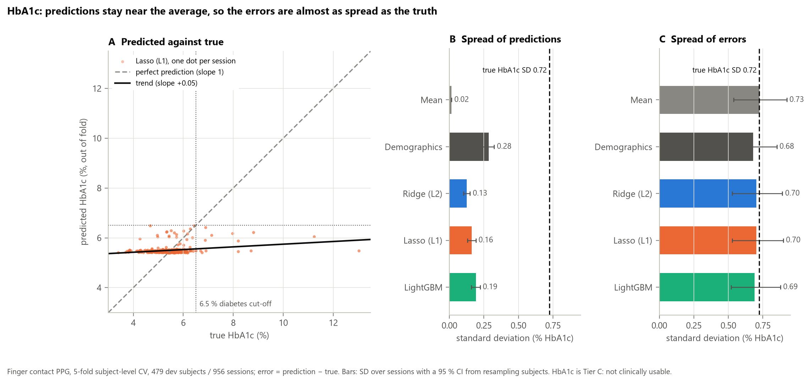

# Phase 3f — HbA1c: predicted against true, and the standard deviations

_Generated 2026-11-02T21:24:14+08:00 by `python -m faceai.report03f` from saved artifacts only._

**HbA1c is Tier C: nothing here is clinically usable.** Same out-of-fold predictions as
Phase 3: **finger contact PPG, 5 dev folds, 479 subjects, 956 sessions, split by subject;
not camera rPPG, not the sealed test set.** No model was refitted for this report.

## 1. Headline



- **The truth is spread out.** True HbA1c averages 5.50 % with an SD of 0.72 %
  (range 3.40–13.02 %); 14 dev subjects are at or above the 6.5 % diabetes cut-off.
- **The predictions are not.** The best PPG model, Lasso (L1), has a prediction SD of 0.16 %,
  22 % of the true spread; across the PPG models it is 17–27 %. Its trend
  has slope +0.05: a 1-point rise in true HbA1c moves the prediction by 0.05 points.
- **No PPG prediction reaches 6.5 %** (highest 6.49 %), so the top-right of panel A is empty
  even though diabetes-range people are in the data.
- **So the errors are almost as spread as the truth.** Error SD 0.70 % against 0.72 % for the
  labels: the PPG models shrink the spread by only 3–5 %. Variance explained is
  1 − (0.70/0.72)² ≈ 5.8 % for Lasso (L1), at most 9.2 % for any PPG model.
  95 % limits of agreement: -1.38 to +1.38 points around the true value.
- **Same as a constant guess.** Lasso (L1) MAE 0.411 [0.363, 0.465] against
  0.414 for predicting the training mean; the constant's error SD is 0.73 %.

## 2. Standard deviations (all models, % HbA1c)

| Model | SD of predictions [95 % CI] | SD of errors [95 % CI] | Error SD ÷ label SD | MAE [95 % CI] | Variance explained (R²) |
|---|---|---|---|---|---|
| True HbA1c (labels) | 0.724 [0.538, 0.921] | — | — | — | — |
| Mean | 0.015 [0.014, 0.016] | 0.726 [0.539, 0.923] | 100.2 % | 0.414 [0.364, 0.471] | -0.4 % |
| Demographics | 0.284 [0.241, 0.324] | 0.678 [0.528, 0.851] | 93.6 % | 0.422 [0.377, 0.474] | +12.3 % |
| Ridge (L2) | 0.126 [0.103, 0.149] | 0.702 [0.527, 0.891] | 96.8 % | 0.414 [0.365, 0.468] | +6.2 % |
| Lasso (L1) | 0.162 [0.130, 0.191] | 0.703 [0.529, 0.897] | 97.1 % | 0.411 [0.363, 0.465] | +5.8 % |
| LightGBM | 0.193 [0.159, 0.222] | 0.690 [0.522, 0.877] | 95.3 % | 0.413 [0.366, 0.467] | +9.2 % |

- SDs are over the 956 sessions (ddof 1). CIs resample the 479 subjects with both their
  sessions together (2000 draws, seed 42), as everywhere else in Phase 3.
- Error = prediction − true. Mean error is ≈ 0 for every model (`reports/03d_bias.md`), so
  the error SD is the spread of the misses and R² = 1 − (error SD ÷ label SD)².
- The mean baseline is refitted on each fold's training subjects, so its prediction SD is
  small but not 0.
- Demographics (age, sex, BMI) has the largest prediction spread and R², and its
  predictions do pass 6.5 %, yet its MAE is worse than the mean's: MAE counts every miss
  equally, while R² squares them and so rewards moving towards the rare high values.

## 3. Provenance

- **Out-of-fold predictions (`artifacts/cv/results.json`)** — generated 2026-10-13T19:32:33+08:00; commit `ad5864c` (uncommitted paths: 0); split SHA-256 `08f6fb63072e…`; db.csv blob `b6db00bc074a…`; lockfile `435869dddb54…`; inputs: `artifacts/features/ppg_clean.parquet` 2014361e6480….
- **Bias (`artifacts/cv/bias.json`)** — generated 2026-10-26T19:45:55+08:00; commit `a901700` (uncommitted paths: 0); split SHA-256 `08f6fb63072e…`; db.csv blob `b6db00bc074a…`; lockfile `435869dddb54…`; inputs: `artifacts/cv/oof.parquet` 8373186ba1f6…, `artifacts/cv/folds.csv` b9763f58510d….
- **Standards (`artifacts/cv/standards.json`)** — generated 2026-10-21T11:21:00+08:00; commit `1e7e1b4` (uncommitted paths: 0); split SHA-256 `08f6fb63072e…`; db.csv blob `b6db00bc074a…`; lockfile `435869dddb54…`; inputs: `artifacts/cv/oof.parquet` 8373186ba1f6….

## 4. Reproduce

```
make cv standards bias   # writes artifacts/cv/oof.parquet, standards.json, bias.json
make report03f
```
